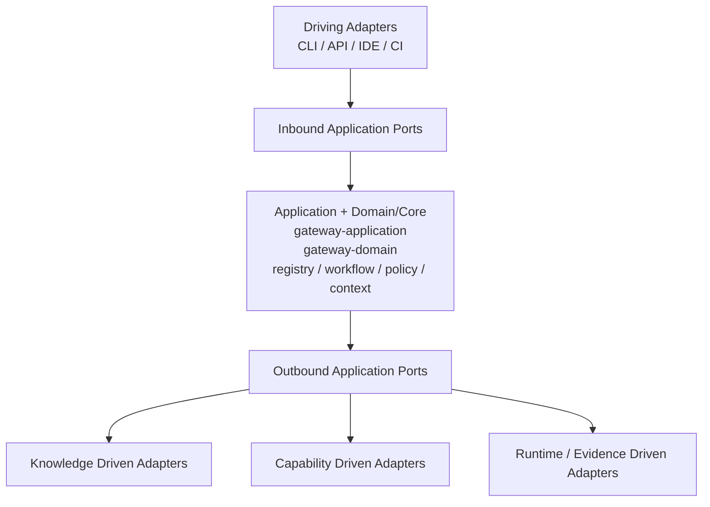

# 5. Building Block View

## 5.1 Level 1

### Gateway Core

The deterministic core follows Hexagonal Architecture. It owns stable domain concepts, application ports, deterministic registries, workflow resolution, policy evaluation and context compilation.

### Cognitive Services

Optional services provide semantic classification, embeddings, RAG, graph retrieval, ranking and summarization. They are outside the deterministic core and connect through knowledge/retrieval ports.

### Execution Runtime Adapters

Codex, PraisonAI, local LLMs and cloud LLM APIs are replaceable driven adapters behind execution-runtime ports.

### Capability Adapters

Repository, Git, quality gates, runtime inspection, GitHub and MCP/tool integrations are controlled adapters behind capability ports. Retrieval never grants capability permissions.

## 5.2 Rust workspace and hexagonal mapping



Initial crates:

```text
crates/
├── gateway-domain/
├── gateway-application/
├── gateway-process/
├── gateway-registry/
├── gateway-workflow/
├── gateway-policy/
├── gateway-context/
└── gateway-daemon/
```

The intended responsibility of each current crate is:

- `gateway-domain`: typed identifiers, immutable definitions, execution state,
  capabilities, constraints, `ExecutionContextIR` and domain validation;
- `gateway-application`: inbound use-case ports, outbound ports and application orchestration;
- `gateway-process`: deterministic process compilation, lifecycle and activity readiness;
- `gateway-registry`: deterministic loading and validation of registered definitions;
- `gateway-workflow`: compile-only placeholder; the former CG-05 registry scope
  was merged into the single `gateway-process` authority under CG-04;
- `gateway-policy`: authorization and fail-closed policy evaluation;
- `gateway-context`: validated context compilation and Execution Context IR handling;
- `gateway-daemon`: composition root and future process/transport wiring, outside the core.

Concrete CLI/API/IDE/CI driving adapters and Git/RAG, MCP/tool, runtime and
evidence driven adapters are outer components. They must implement the
contracts exposed by `gateway-application` rather than introduce dependencies
into `gateway-domain` or the deterministic core.

### Legal dependency direction

- `gateway-domain` contains stable domain concepts and has no provider,
  transport or infrastructure dependency; `serde` and `serde_json` are the
  explicitly allowed serialization dependencies for the versioned wire
  contract.
- `gateway-application` contains application use cases and defines inbound and outbound ports; it composes `gateway-domain`, `gateway-registry`, `gateway-process`, `gateway-policy` and `gateway-context`. These deterministic components depend on domain contracts and never depend back on application.
- `gateway-registry`, `gateway-workflow`, `gateway-policy` and `gateway-context` are deterministic inner components and depend only on inner abstractions required by their responsibility.
- `gateway-daemon` is the initial outer composition root and may depend on inner crates and, later, on concrete adapters.
- driving adapters may call inbound ports; driven adapters may implement outbound ports. Both depend on core-defined contracts.
- the core must never depend on adapters, transport frameworks, providers, databases, Git/GitHub details or concrete MCP implementations.
- circular crate dependencies are forbidden.

### Adapter attachment points

```text
KnowledgePort       <- existing Git / filesystem knowledge adapters
RetrievalPlanner    <- explicit bounded retrieval planning
KnowledgeRetrievalPort <- lexical / semantic / graph / memory adapters
EmbeddingPort       <- replaceable embedding services
TokenEstimatorPort  <- replaceable tokenizer / estimation services
ReasoningAdapter    <- provider strategy support and bounded attempt adapters
CapabilityPort      <- MCP / Git / quality / GitHub / runtime-tool adapters
ExecutionRuntimePort<- Codex / PraisonAI / local/cloud LLM adapters
EvidencePort        <- audit/evidence persistence adapters
```

These are attachment points, not permissions. The policy engine decides whether a capability request is allowed; an adapter only performs the operation authorized through its port. Knowledge adapters return knowledge and provenance, never authority or permissions.

The application boundary represents consuming-project configuration as an
opaque request-scoped `ProjectContext`. A `KnowledgeRequest` may carry that
scope explicitly, while a knowledge adapter returns typed `RetrievedKnowledge`
with `KnowledgeProvenance`. Neither value is a catalog definition or an
authority-bearing execution field.

The adapter technologies are replaceable implementation choices. Their
provider-specific configuration and behavior do not belong in the domain
contract.

CG-15 adds versioned retrieval IR in `gateway-domain::retrieval_plane` with
immutable executable plans, explicit finite budgets and stop conditions,
scoped provenance, derived embedding lineage, and exact/estimated/unknown token
counts. The application owns all four new outbound traits. No new dependency
edge is needed. See [the retrieval contract](../retrieval-plane.md) and
[ADR-011](../adr/ADR-011-modular-retrieval-plane.md).

CG-16 adds deterministic federation, fusion and reranking contracts in
`gateway-application` and filesystem/Git plus in-memory vector adapters in
the outer `gateway-daemon` crate. The vector adapter uses the embedding port
and checks source snapshots before search. See
[the retrieval pipeline](../retrieval-pipeline.md).

CG-17 adds versioned graph nodes, edges and derived projection manifests in
`gateway-domain`. `gateway-application` owns bounded, deterministic traversal
and the replaceable `GraphProjectionPort`. An in-memory graph store and a CG-16
graph source adapter live in `gateway-daemon`. Source snapshots determine
projection eligibility; graph paths retain original scope and provenance and
cannot grant authority. See [knowledge graph and graph retrieval](../knowledge-graph.md).

CG-19 adds deterministic sufficiency assessment to the domain and bounded
round orchestration to the application. Refiners propose only query sets;
the evidence port validates links. Retrieval findings may pause CG-14 but
cannot authorize execution or alter process state. See
[recursive retrieval](../recursive-retrieval.md).

CG-20 adds provider-independent evaluation and release-threshold contracts in
`gateway-domain`, reference-only curated export and diagnostic profiling in
`gateway-application`, and versioned datasets and gate automation outside the
core. CG-20D consumes these contracts in an external-project fake-port replay.
Neither evaluation scores nor exported memory grant process or policy authority.
See [EPIC-02 evaluation](../epic-02-evaluation.md) and [ADR-014](../adr/ADR-014-versioned-evaluation-and-learning-export.md).

## 5.3 Proposed Python services

```text
cognitive-services/
├── classifier/
├── embeddings/
├── retrieval/
└── graph/
```

Python cognitive services remain optional and sit outside the deterministic Rust core.

## 5.4 Agent and Skill catalog

```text
catalog/
├── agents/
└── skills/
```

The catalog is the sole built-in Agent and Skill definition boundary. It
contains reusable, schema-validated definitions and has no project namespace
or override layer. Consuming-project repository content, configuration and
runtime state are supplied through explicit ports and adapters. Agent and
Skill documents may carry typed `provided_capabilities` contracts containing
canonical identity, domain, inspect/mutate class, input/output kinds,
intrinsic preconditions and deterministic applicability tags. These contracts
describe reusable provider capability only; policy still decides whether an
execution may use it.

### Enforced dependency graph (CG-13)

`scripts/check-dependencies.py` checks Cargo metadata for every workspace
member and every normal, development, build, optional and target dependency.
The reviewed direct dependency allowlist is:

| Crate | Allowed workspace dependencies | Allowed external dependencies |
| --- | --- | --- |
| domain | none | serde, serde_json |
| application | domain, registry, process, policy, context | serde, serde_json, sha2 |
| registry | domain | none |
| workflow | domain | none |
| process | domain | serde, serde_json, sha2 |
| policy | domain | serde, serde_json (test support) |
| context | domain | serde, serde_json |
| daemon | all seven inner crates | serde, serde_json, sha2 |

Crate names in the table have the `gateway-` prefix. New workspace members,
dependency edges or external libraries require a reviewed update to this table
and the executable allowlist. Renaming a dependency does not change its package
identity. Core dependencies must resolve to the workspace source. Cargo checks
its full resolved graph for cycles; the guard also checks workspace edges.
Transitive serialization/cryptography implementation dependencies remain
controlled by `Cargo.lock`; this check is not a dependency vulnerability audit.

## CG-18 governed memory boundary

`gateway-domain::memory` defines versioned experience, curation and eligibility references.
`gateway-application::memory` owns admission, lifecycle decisions, scoped recall and
revalidation of pinned learning references through `MemoryStore`. The outer
`gateway-daemon::memory` adapter proves atomic revision checks and payload erasure
in memory; production persistence must provide durable atomic commits and retain
revocation history. CG-10 receives only eligible memory as a derived-assessment
fragment with validation and revision. Memory text has no authority over policy,
capabilities or process state. See [governed memory](../governed-memory.md).

CG-20B keeps deterministic context selection in `gateway-context`, composes
current authorization and estimation in `gateway-application`, and exposes
optional tokenizer and compaction ports to outer adapters. See
[context budgeting](../context-budgeting.md).

## 5.5 Semantic interpretation plane (partial EPIC-05)

`gateway-cgsl` implements the offline parser, source AST and semantic compiler
using the existing `gateway-domain` contracts. It preserves unresolved source
sidecars and produces task shapes without granting execution authority. See the
[frontend boundary and verification](../cgsl-frontend.md). `gateway-application`
provides [deterministic interpretation resolution](../deterministic-interpretation-resolution.md)
with scoped lookup ports, typed context, precedence and decision traces.
The [semantic planning boundary](../semantic-planning-boundaries.md) maps CG-06
Intent/Context/Situation inputs into task compilation and delegates validated task
planning and resolution to the existing CG-07/08 facades. Its immutable handoff
retains output, verification and evidence contracts beside Plan. Host/runtime
integration remains separate. Optional model interpretation produces proposals only; a
deterministic compiler/validator owns canonical semantics. See
[semantic language and interpretation](../semantic-language-and-interpretation.md).

## 5.6 MCP connector/plugin runtime (planned EPIC-07)

The MCP client/runtime is an outer infrastructure block. It owns transport,
server lifecycle, discovery and invocation. Canonical source/capability
mapping, scope, provenance, trust, sensitivity, authorization and retry
decisions remain Gateway responsibilities. GitHub is a reference connector,
not a core dependency. See [MCP connector runtime](../mcp-connector-runtime.md).

## 5.7 Codex local adapter (planned EPIC-04)

The Codex-facing local MCP adapter is a driving adapter into a shared
application facade. It must not reproduce connector runtime logic and must not
bring Codex/OpenAI types into authoritative contracts. See
[Codex local integration](../codex-local-integration.md) and the defined
[versioned wire contracts](../codex-facing-contracts.md). Server/facade and
shared session runtime implementation remain planned.

## 5.8 Local inference runtime (CG-27.01 reference service)

Local inference is a separately replaceable driven service behind a stable
port. Model/runtime profile, artifact digest, quantization, capability and
qualification metadata are explicit. The deterministic core must continue to
operate when the runtime is unavailable. See
[local model runtime](../local-model-runtime.md).

## 5.9 Learned procedure domain (CG-21 foundation implemented)

`gateway-domain::learning` defines situation fingerprints, eligible
experience bases, pattern candidates, immutable/digest-bound learned
procedures, procedure steps referencing existing process/capability/policy
identities, verification requirements and append-only lifecycle transitions.
These types support EPIC-03 without allowing historical experience to become
authorization. See [learned procedures](../learned-procedures.md).

CG-23 adds pure versioned replay/evidence contracts in `gateway-domain`, real
Process/Policy simulation capture in `gateway-application`, and evaluate/simulate/replay
commands in the CLI adapter. See [procedure evaluation](../procedure-evaluation.md).

The CG-27.01 reference deployment, provider-neutral port and qualification lifecycle
are implemented; see [the operator guide](../local-model-runtime.md).
EPIC-05.11 supplies optional interpretation proposal adapters at component level;
complete hosted interpretation and model invocation remain separate integration work.

CG-27 adds an optional four-task cognitive signal adapter and standalone benchmark
harness. Versioned datasets and exact invocation provenance bind CPU/GPU reports;
fixture observations are explicitly distinct from model measurements and product
claims. Benchmarking does not promote models or mutate authoritative state.

## Governed offline learning (CG-28)

`gateway-domain::offline_learning` contains reference-only signal, dataset, recipe,
model release and upgrade-impact contracts. `gateway-application::offline_learning`
validates memory and exact evidence, builds deterministic scoped datasets and
coordinates explicitly authorized isolated training/evaluation ports.
`gateway-application::model_releases` gates immutable release registration, canary
observations, activation and exact predecessor rollback with independent authority.
The daemon inference path does not call training. Concrete offline workers and
atomic durable release/routing stores remain outer adapters. See
[the CG-28 contract and operator procedure](../offline-learning.md).

## Semantic component ownership detail

| Module / port | Responsibility and boundary |
| --- | --- |
| `gateway-cgsl` | Offline parser, AST, typed compiler, formatter/serializer; depends inward on domain, not on application or a process/provider parser |
| `gateway-domain` | SemanticTaskIR, output/verification, interpretation, gap and evidence types and canonical invariants |
| `gateway-application::interpretation` / `completeness` | Deterministic resolution, host-authenticated mandatory manifest, clarification frontier and revalidated compiler callback |
| `gateway-application::inspection_language` | Bounded original-text inspection profile; input digest and spans, deterministic target query, existing completeness/reference checks; no new authority or runtime |
| `gateway-application::semantic_planning` | CG-06 mapping and immutable semantic envelope; invokes existing CG-07/08 without duplicate planners |
| `gateway-process` / CG-09 | Process definition, lifecycle, gates and policy authority; CGSL carries a definition pin only |
| CG-10 / outer invocation adapters | Context compilation; prompt layout references are test-only, production #263 remains downstream |

See the [implementer guide](../cgsl-implementer-guide.md) for all contracts,
source-to-IR stages. [Context requirement planning](../context-requirement-planning.md)
implements #285 in the domain/application modules and the real CG-10 handoff;
[#286 dynamic example selection](../dynamic-example-selection.md) adds canonical
example contracts, deterministic selection and a dedicated CG-10 examples section.

### Context requirement and source planning (#285)

`gateway-domain::context_planning` owns versioned immutable requirements and plans,
reusing CG-15 information, trust, freshness, provenance, budgets and stop contracts.
`gateway-application::context_planning` validates the semantic basis, analyzes the
task and captured CG-07 information needs, selects finite source metadata and maps
retrievable needs into CG-15. No acquisition adapter is called by planning.
`gateway-context::planning` validates the actual producer records against a real
compiled context and preserves exact bindings, satisfaction and resolved output/
verification contracts in the #192 handoff. #263 production invocation is separate.

### Dynamic example selection (#286)

`gateway-domain::example_selection` owns immutable requirement/set contracts,
captured CG-16 candidate fragments, exact compatibility and validating constructors.
`gateway-application::example_selection` filters authenticated metadata/quarantine,
ranks eligible demonstrations, suppresses redundancy and enforces CG-20B bounds.
The optional `ExampleRanker` port cannot change eligibility or authority.
`gateway-context::planning` verifies the set pin and #285 satisfaction link, keeps
examples separate from instructions/evidence, and applies CG-10 disclosure to audit
exports. Existing retrieval/memory/promotion owners still supply captured data.

## EPIC-06.01 model contract foundation

`gateway-domain::model_invocation` owns immutable provider-neutral capabilities,
provider declarations, generation profiles and task/context/output/tool bindings.
`gateway-application::model_invocation` prepares strictly negotiated adapter inputs
behind `ModelInvocationPort`; mutable health remains separate from semantic eligibility.
See [model invocation contracts](../model-invocation-contracts.md). Existing CG-26
routing and CG-27 inference consumers retain their current paths. The strict
#262 routing service below integrates capability negotiation with CG-26; #263 owns
full semantic-handoff integration.


## EPIC-06.04 semantic rendering boundary

`gateway-domain::prompt_rendering` owns versioned tokenizer profile, component
usage, count mode/provenance and budget snapshot contracts.
`gateway-application::prompt_rendering` owns exact handoff/model/tool correlation,
`PromptRendererPort`, `TokenizerPort` and the sealed successful render. Outer
`gateway-daemon::prompt_renderers` owns both concrete runtime message formats.
No renderer dependency enters CGSL, domain or CG-10. The existing planned handoff
remains the semantic producer; no competing Prompt/Invocation IR is introduced.

## EPIC-06.02 invocation-aware routing

`gateway-application::model_routing` composes the existing CG-26 router with
EPIC-06.01 strict preparation. Versioned host snapshots bind model candidates to
admitted invocations, canonical capability/provider declarations and independent
health observations. `InvocationRouteRuntime` keeps CG-10/Process/Policy admission
and adapter dispatch with the host. There is one CG-26 ranking/execution owner.
See [routing contracts and operator integration](../model-capability-routing.md).

## Provider-independent invocation IR (#263)

`gateway-domain::prompt_ir` owns producer pins, identity and diagnostics.
`gateway-application::prompt_ir` owns immutable `PromptIr`/`InvocationIr`, current
semantic reference/admission checks, correlated rendering and proposal transport
ports. It reuses the typed CG-10 producer; no domain dependency on context, provider
SDK or second planner/router is introduced. Trusted stores/current Process/Policy
remain host responsibilities. See [contract and evidence](../prompt-invocation-ir.md).

### Output verification — EPIC-06.06

`gateway-domain::output_verification` owns versioned proposal/correlation/audit
records and pure structural validation. The application service composes the
strict bounded parser, captured schema/tool inventory, existing semantic-result
assessment and mandatory `OutputVerificationPort` checks. Its host extends
`InvocationAdmissionPort` for current task/context/Process/Policy admission;
reference resolution and rule execution stay with their existing owners. There
is no provider or effect dependency. See [integration and evidence](../output-verification.md).

### Structured output parsing — EPIC-06.05

`gateway-application::output_parsing` reuses the #266 strict parser and proposals,
checks the exact admitted schema/inventory, and owns provisional stream buffers
and bounded repair sessions. The domain owns completion/repair audit contracts;
the mandatory budget port delegates aggregate accounting to the trusted host.
See [operator and contract guide](../structured-output-parsing.md).

### Evidence and grounding verification

`gateway-domain::grounding` owns version 1 trusted claim/snapshot contracts and stable diagnostics. `gateway-application::grounding` reuses EPIC-02 provenance, CG-06 evidence and existing quality types. `OutputVerificationPort` exposes the required `GroundingEvidencePort` for evidence/claim rules; store authentication and independent observation remain adapter responsibilities. See [integration and operator guidance](../evidence-grounding-verification.md).

### Bounded invocation resilience — EPIC-06.08

Domain versioned limits/usage contracts and the application `InvocationRun`
compose admitted/rendered IRs, CG-14 lifecycle decisions and the shared request
context with a replaceable bounded provider port. One ledger accounts for every
retry/repair/fallback; no provider SDK, connector effect or second lifecycle
controller enters the core. See [integration and evidence](../invocation-resilience.md).

### Local and independent model adapters — EPIC-06.09

`gateway-daemon::model_adapters` implements the existing bounded invocation port
for the CG-27 local service and an independent Chat Completions provider.
Adapter renderers include full wire controls/schema before token accounting;
Rust owns admission, aggregate budgets and verification. The optional Python
`canonical.py` bridge maps `/v1/invoke` to the qualified local runtime without
replacing the legacy `/v1/infer` contract. Credentials remain outer runtime state.
See [adapter integration and qualification](../model-provider-adapters.md).
