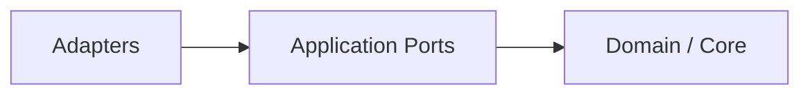

# 8. Cross-Cutting Concepts

## 8.1 Authority and provenance

Every context fragment should retain provenance. Gateway-owned governance and
policy content must be traceable to canonical repository sources. Consuming
project content is contextual input and must remain distinguishable from the
definitions that establish catalog membership.

## 8.2 Explainability

Resolver and policy decisions must produce machine-readable reasons describing:

- matched rules;
- selected dependencies;
- rejected alternatives;
- policy allow/deny decisions;
- missing or invalid references.

## 8.3 Fail-closed behavior

Unknown definitions, malformed catalog documents and unauthorized capabilities
are rejected by default.

## 8.4 Stable versus dynamic context

The compiler separates stable governance/policy/workflow/agent/skill contracts
from dynamic task and execution state. The provider-independent IR carries
these values; runtime-specific prompt or request rendering is outside the
domain contract.

## 8.5 Capability classes

At minimum, capabilities are divided into `inspect` and `mutate`. Mutations can require additional policy checks and explicit user authorization. Agent and Skill contracts may expose a reusable capability declaration with a canonical identity, domain, purpose, typed input/output kinds, intrinsic preconditions and constraints, and deterministic applicability tags. This metadata describes what a provider can do; policy remains authoritative for whether it may be used.

## 8.6 Knowledge retrieval

Retrieval is advisory and evidence-producing. It must not directly create new authorities, permissions, agents, skills or workflows. The application retrieval contract returns typed knowledge with source and optional revision provenance; project configuration is an explicit request-scoped input and remains outside the catalog and execution IR.

## 8.7 State model

Operating Mode, Execution Profile, workflow, gate and blocker state are
explicit machine-readable data rather than implicit prompt text. The current
domain contract does not model a separate slice or authorization-state object;
capability approval and policy decisions are represented explicitly in the IR.

The domain currently models `WorkflowState`, `GateState` and `BlockerState` as
strict, independently parseable state machines. `ExecutionState` validates
their coordinated invariants: blocked execution requires an active blocker and
a blocked gate; completion requires a passed or skipped gate; and active
blockers cannot coexist with running or terminal workflows. Unknown values and
illegal transitions fail closed. `OperatingMode` and `ExecutionProfile` stay
orthogonal, with request-specific restrictions represented by explicit
constraints rather than hard-coded coupling.

Capabilities are classified as `INSPECT` or `MUTATE`. Constraints are typed
domain declarations, including feature freeze, consent for live mutation and
an optional full-path requirement for release qualification. Neither type
contains provider handles or executes an adapter operation.

## 8.8 Dependency inversion and adapter replaceability

The deterministic Rust core follows Hexagonal Architecture. Domain and application contracts are stable inner abstractions; infrastructure and execution technologies are replaceable outer adapters.

The dependency rule is inward-only:

RAG implementations depend on knowledge/retrieval ports, MCP/tool implementations depend on capability ports, and execution runtimes depend on runtime ports. None of these technologies may become a dependency of `gateway-domain`.

This enables isolated unit testing through port doubles, architecture verification from Cargo manifests, and replacement of infrastructure without rewriting core behavior.

Ports are owned by the inner application/domain model and describe stable contracts rather than vendor protocols. Driving adapters translate external requests into inbound ports; driven adapters implement outbound ports. This keeps transport, storage, model-provider, MCP and runtime concerns replaceable.

## 8.9 Auditability and separation of concerns

Each routing, policy and adapter interaction should be explainable through structured evidence: the selected or rejected definitions, the policy decision, the port used, adapter provenance and the resulting state. Evidence is observational; it cannot grant authority.

Authority, knowledge and capability remain separate planes:

- authority comes from canonical governance and policy sources;
- knowledge adapters retrieve information and provenance;
- capability adapters perform only operations authorized by the core.

RAG output therefore remains advisory, MCP/tool output remains capability-scoped, and execution runtimes remain consumers of the compiled context rather than policy authorities.

## 8.10 Architecture guard

The repository provides `scripts/check-architecture.sh` to enforce the reviewed Cargo dependency graph and catalog/project separation. Cargo metadata covers dependency aliases, target-specific dependencies and development/build dependencies. Mutation tests in `tests/architecture/` prove that forbidden edges and substituted sources fail. The complete [declarative v0.1 gate](../declarative-quality-gates.md) runs these checks locally and in CI and retains release evidence.

## 8.11 Domain primitive validation

The domain crate uses distinct validated newtypes for task, agent, skill, workflow, policy, execution-context and capability identifiers. Identifiers are 1–128 characters, use only ASCII letters, digits, `-`, `_` and `.`, and must begin and end with an ASCII alphanumeric character. Identifiers are never silently trimmed or normalized; malformed values are rejected by their constructors and parsing implementations.

Required textual values must contain a non-whitespace character, be no longer than 16,384 characters, and contain no control characters other than tab, line feed and carriage return. `SchemaVersion` is a major/minor value object; major version zero is reserved and malformed version strings fail parsing. These rules are deterministic, side-effect free and independent of serialization frameworks or execution providers.

## 8.12 Semantic determinism and ambiguity

Natural-language interpretation is allowed to be probabilistic at the system
boundary, but canonical task semantics are not. EPIC-05 requires unresolved,
ambiguous and conflicting mandatory semantics to remain explicit. Model output
may nominate candidates but cannot silently fill required facts. CGSL describes
task meaning and remains separate from Process IR execution semantics and
provider-specific prompt rendering.

The [normative task/process boundary](../semantic-process-boundary.md) defines
the exact ID/version/digest mapping from the domain `ProcessReference` to CG-04
`DefinitionIdentity`. CG-07 plans task meaning; CG-08 selects applicable process
definitions using explicit rules; CG-04 alone evaluates process transitions.
Task state predicates, verification obligations and history cannot mutate process
state or satisfy gates. Dependency mutation tests, CGSL/IR lifecycle rejection
tests and a dual-frontend reference scenario enforce this separation (#191).

## 8.13 Model provenance and qualification

The [Prompt IR handoff boundary](../prompt-ir-handoff-boundary.md) (#192) keeps
task meaning, authenticated instructions, context, evidence, optional bounded
examples and output/verification contracts separate. #285 owns canonical context
requirements/source selection; #286 owns validated examples; CG-10 owns final
context compilation. EPIC-06 #263 consumes their exact version/digest bindings
and owns invocation admission. Renderers cannot infer requirements, acquire
hidden context or promote examples to policy authority. Existing CG-26 routing
attaches after admission and revalidates CG-10 before each dispatch. #266/#267
verify outputs against the exact invocation independently of provider confidence.
The boundary specification and two offline reference layouts are available;
[#285 canonical producer/CG-10 integration](../context-requirement-planning.md)
and [#286 canonical examples](../dynamic-example-selection.md) are implemented
and checked through the actual CG-10 handoff offline. The #263 production
envelope remains separate work.

Local or remote model use must retain provider/model identity and the
configuration needed to reproduce material behavior where applicable. CG-27
adds model revision/digest, runtime version, quantization and prompt/template
provenance plus explicit qualification/promotion/rollback. Model output remains
non-authoritative even after qualification.

## 8.14 MCP trust and credential isolation

MCP discovery never grants permission or trust. External resource/tool results
must be normalized into canonical evidence/capability contracts. Credentials
are resolved in outer runtime infrastructure and must not be serialized into
Intent, Plan, Evidence, compiled model context or audit payloads. Mutation
retry safety is explicit and never guessed from model output.

## 8.15 Governed procedural learning

CG-21 separates eligible historical experience, pattern candidates, immutable
learned procedure content and procedure lifecycle state. A learned procedure
references existing process/capability/policy identities and therefore cannot
manufacture authority. Each immutable version is digest-bound and lifecycle
decisions are append-only, inspectable events. The wider EPIC-03 reflex and
automatic pattern-discovery behavior remains gated by evaluation, approval and
verification.

## CGSL canonical identity, evolution and conformance

CGSL 1.0 source and SemanticTaskIR 1.0 are independently versioned closed
contracts. The formatter preserves interpretation sidecars and exact source
number tokens. Semantic serialization projects admitted IR and emits empty
sidecars. Only compact canonical task JSON is hashed as task identity; pretty
source bytes are not digest input. Old readers reject unsupported minor as well
as major versions, and unknown semantics cannot be dropped. See the
[language specification](../cgsl-language-v1.md) and [migration guide](../cgsl-migration.md).

The [portable conformance corpus](../cgsl-conformance.md) freezes canonical
bytes/digests and diagnostic classes independently of implementation discovery.
Reference truth, scope, freshness and policy require trusted captured-basis
admission. Component conformance does not establish production source authenticity,
result verification or installed-runtime qualification.

## Context planning identity and bounded sufficiency

Requirements are independent of source availability. Every requirement preserves
necessity, ordered permitted source classes, CG-15 suitability constraints,
hard budgets and stop conditions. Plans distinguish present and pending content,
record explicit missing needs and class-level `NONE_REQUIRED` decisions, and
retain deterministic selection/rejection reasons. Canonical SHA-256 bindings
cover full requirement/plan metadata and the captured task/Situation/Plan pins.
CG-10 correlates actual selected fragment identities, exact source revisions,
quality and payload digests; mandatory unsatisfied needs block the handoff.
Dynamic data cannot supply authority or cross scope, and compilation/rendering
cannot acquire replacement context. See [the contract](../context-requirement-planning.md).

## Versioned model generation inputs (#261)

Provider-neutral immutable generation profiles reject non-finite values and use
ordered controls/stops plus zero normalization for deterministic bytes. Effective
records distinguish requested values, declared defaults and unexposed defaults.
Seeds are hints, never proof of deterministic generation. Invocation pins preserve
task/context/output revisions, permitted capabilities, locality, sensitivity and
Process/Policy authority; outer adapters cannot silently discard controls.
See [contracts and diagnostics](../model-invocation-contracts.md).
