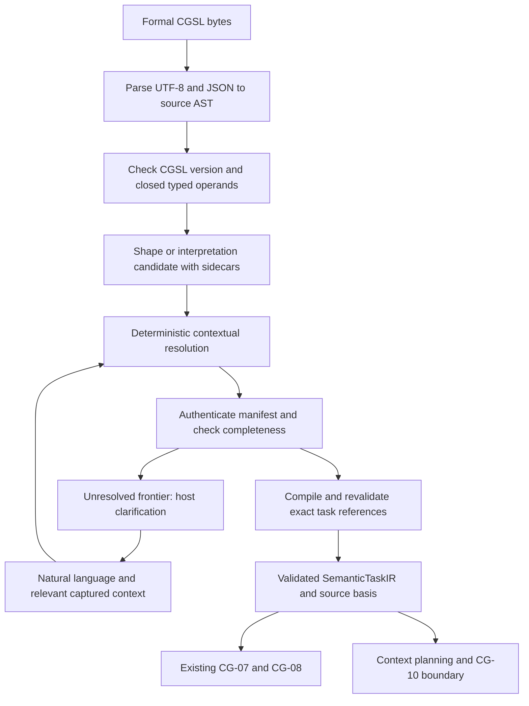

# CGSL implementer guide

This is the entry point for implementing and independently reproducing CGSL 1.0
and SemanticTaskIR 1.0. It completes the documentation scope of EPIC-05.16 #194.
The specifications below define the contract; issue history is not required.
MUST/MUST NOT in those specifications are conformance requirements. This guide
does not introduce another syntax, wire schema or authority model.

## Read and implement in this order

| Step | Normative contract | Implementation responsibility |
| --- | --- | --- |
| 1 | [Scope and finite vocabulary](cgsl-scope-and-vocabulary.md) | Task meaning only; reuse CG-02/06 identities, state and evidence |
| 2 | [Language 1.0](cgsl-language-v1.md) | Strict UTF-8 JSON, closed operands, exact numbers, AST spans, ordered diagnostics, formatter and semantic serializer |
| 3 | [SemanticTaskIR 1.0](semantic-task-ir-v1.md) and [wire schema](../schemas/semantic-task.schema.json) | Typed invariants, canonical bytes and SHA-256, independently versioned exact references |
| 4 | [Interpretation Context](interpretation-context.md) and [deterministic resolution](deterministic-interpretation-resolution.md) | Authenticate a captured request/scope/revision; apply deterministic precedence and retain candidate provenance |
| 5 | [Resolution states](semantic-resolution-contracts.md), [epistemic contract](semantic-epistemic-contract.md), [completeness](semantic-completeness.md) | Preserve gaps/conflicts/ambiguity; derive all mandatory requirements; clarify only the unresolved dependency frontier |
| 6 | [Output and verification](semantic-output-contracts.md) | Authenticate external schema/check definitions; keep obligations distinct from successful verification |
| 7 | [Planning](semantic-planning-boundaries.md), [Process IR](semantic-process-boundary.md), [Prompt IR](prompt-ir-handoff-boundary.md) | Retain complete semantics alongside downstream artifacts; enforce each owner's admission boundary |
| 8 | [Migration](cgsl-migration.md), [conformance](cgsl-conformance.md), [reference walkthroughs](cgsl-reference-examples.md) | Run portable frozen vectors and denied paths; distinguish source formatting from task identity |

## Compilation stages and admission



The arrows describe composition responsibilities. They do not assert a shipped
natural-language CLI or a single production coordinator. The Rust frontend
`gateway_cgsl::compile` stops at typed shape/sidecars. `task_shape()` is not
executable admission. The application resolver and completeness compiler need
trusted host ports and a captured authoritative basis. An unavailable source is
not proof that an entity does not exist. Source-authored provenance and high
confidence cannot authenticate a reference or grant consent.

Facts, observations, evidence, inferences, hypotheses and assumptions retain
their classifications and original provenance. Freshness, scope and source
eligibility are checked before a candidate can satisfy a mandatory requirement.
Confidence cannot break ambiguity or turn an assumption into a fact. Interpretation
sidecars are retained by source formatting and deliberately excluded from the
task digest; discarding them is a projection, not a lossless source roundtrip.

## Delivered component and future runtime boundary

As inspected on 2026-10-17, the offline frontend, canonical formatter/serializer,
typed task/output/resolution contracts, deterministic resolver, completeness and
optional proposal adapters exist. The CG-06/07/08 adapter and Process IR boundary
have executable component proofs. The portable conformance suite freezes source,
canonical IR, digest and resolution expectations.

The Prompt IR boundary has two offline reference renderings. Its supplemental
planning/example records are test-only consumer views. Canonical context
requirements/source selection (#285), dynamic example selection (#286), production
Prompt/Invocation IR admission (#263), persisted clarification hosting (#275) and
full runtime proof (#279) remain separate integration work. No complete arbitrary
natural-language interpreter, real model invocation or external effect is
qualified by these component tests. See [architecture state](current-architecture-state.md).

## Reproduce without an installed runtime

Run from the checkout root with the repository Rust toolchain:

```sh
cargo test -p gateway-cgsl --all-targets --locked
cargo test -p gateway-application --test interpretation --test completeness --test semantic_planning --locked
cargo test -p gateway-domain --test semantic_task_v1 --test semantic_resolution --test semantic_output --locked
cargo test -p gateway-context --test prompt_handoff_reference --locked
```

These tests require no model, network, database or tool credentials. A second
implementation should consume the [data corpus and host/query profile](../tests/fixtures/cgsl-conformance-v1/README.md)
directly and compare frozen bytes, digests, diagnostic classes and complete
resolution candidates. Passing the Rust tests establishes reference-component
behavior; it does not qualify a second implementation or a deployed host.

The [EPIC-05.16 review and evidence record](epic-05.16-documentation-review.md)
maps documentation acceptance to source inspection and executed regressions.
