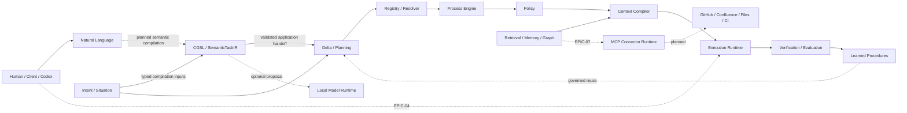

# Current Architecture State

Current full-parent acceptance is governed by [EPIC-04 acceptance](epic-04-acceptance.md).
Shared structured services and installed-client lifecycle proof are delivered;
older evidence below retains its historical scope. Fresh full reconciliation
determines the current parent acceptance state.

**Reference date:** 2026-10-11; semantic-plane entries reconciled 2026-10-17

This document is the compact status map for the current Cognitive Gateway architecture. It distinguishes implemented contracts from planned architecture so that issue descriptions, arc42 and code are not accidentally treated as equivalent maturity.

## Status legend

- **IMPLEMENTED** — present in the default branch with executable code/tests or an established shipped contract.
- **PARTIAL** — foundations exist, but the complete vertical slice is not yet implemented.
- **PLANNED** — defined in an Epic/issue and part of the target architecture, but not yet a completed runtime capability.

## Current system map

## Capability status

| Area | Status | Notes |
| --- | --- | --- |
| Typed domain model / ExecutionContextIR | IMPLEMENTED | Versioned domain and serialization contracts exist. |
| Agent / Skill / Capability registry | IMPLEMENTED | Deterministic catalog and resolution foundations exist. |
| Process engine | IMPLEMENTED | Deterministic process semantics and integration proof exist. |
| Intent / Situation / declarative planning | IMPLEMENTED | CG-06 / CG-07 contracts and application flow are documented and tested. |
| Resolver / explainability | IMPLEMENTED / PARTIAL | Major CG-08 contracts exist; acceptance remains tied to documented integration constraints. |
| Policy and inspect/mutate separation | IMPLEMENTED | Policy remains the authority boundary for executable capability use. |
| Context compiler | IMPLEMENTED | Provider-independent context construction is available. |
| Retrieval / vector / graph / memory | IMPLEMENTED | CG-15 through CG-20 foundations are present. |
| Closed-loop execution | IMPLEMENTED | Bounded reassessment/replanning flow exists. |
| Parallel task execution | IMPLEMENTED | CG-28A bounded parallel scheduling is present. |
| Learned procedure domain contracts | IMPLEMENTED | CG-21 foundation added on 2026-10-03. |
| Experience normalization and pattern inspection | IMPLEMENTED | CG-22 correlates governed, verified outcomes and supports PostgreSQL backed inspection; it creates candidates without executable authority. |
| Learned procedure discovery/promotion/reflex runtime | IMPLEMENTED (governed reference runtime) | CG-21 through CG-25 and CG-30 demonstrate experience → detected pattern → evaluated procedure → governed promotion → reflex, fallback and rollback. |
| CGSL / SemanticTaskIR | PARTIAL (components implemented; full hosted runtime pending) | [Implementer guide](cgsl-implementer-guide.md): normative CGSL/task contracts, offline parser/compiler/formatter/serializer, deterministic resolution, completeness/clarification, optional proposals and CG-06/07/08 adapter are implemented. Process boundary and two offline prompt renderings have component proofs. [Conformance](cgsl-conformance.md) freezes portable source/IR/digest and adversarial expectations. #285 [canonical requirements/source planning and CG-10 handoff](context-requirement-planning.md) are implemented with offline conformance; #286 [canonical example selection and dedicated CG-10 handoff](dynamic-example-selection.md) are implemented with offline conformance; #263 [invocation IR/admission](prompt-invocation-ir.md) is implemented as an application boundary; #275 clarification host and #279 installed runtime integration remain separate. |
| Natural-language-to-IR compiler | IMPLEMENTED (bounded inspection profile); general runtime PARTIAL | The [inspection profile](cgsl-implementer-guide.md#supported-natural-language-inspection-profile) compiles original `Inspect artifact <id>` / `Inspect it` text through host-bound resolution/completeness to validated task IR. Formal CGSL compiles offline. General interpretation and the installed natural-language runtime path are not qualified. See [reference walkthroughs](cgsl-reference-examples.md). |
| Optional SLM semantic interpreter | PARTIAL (proposal adapters implemented) | [Optional interpretation adapters](interpretation-adapters.md) validate classifier/embedding/SLM proposals and preserve deterministic fallback; model output is never authoritative. Full semantic host/runtime qualification remains separate. |
| Local SLM/LxM runtime | IMPLEMENTED (reference service) | CG-27.01: separate CPU-first Ollama/Python containers, Rust port/adapter, immutable profiles, qualification, promotion and rollback. EPIC-05.11 proposal adapters exist; complete hosted interpretation remains separate integration work. |
| Local cognitive signal benchmarks | IMPLEMENTED | CG-27: replaceable four-task proposal adapter, versioned synthetic dataset, fixture and Ollama CPU/GPU harness, per-sample provenance and explicit failure/fallback evidence. |
| Governed offline learning pipeline | IMPLEMENTED (contracts and reference coordinator) | CG-28 validates signals, assembles scoped/versioned datasets, gates offline jobs/evaluation and journals canary/rollback. Concrete CPU feature/training/CV/calibration worker, PostgreSQL release journals and current-version inference/rollback are implemented; see complete EPIC-03 acceptance. |
| Distributed cognitive worker fabric | IMPLEMENTED (contracts and local reference) | CG-29: immutable scoped snapshots, bounded queue/retries, fenced leases, provenance and a local worker adapter. PostgreSQL coordination preserves leases/fencing/idempotency across restart; Linux process and isolated container resource enforcement are implemented. Swarm/Kubernetes transport remains optional. |
| Qwen3-8B reference profile | PLANNED | Reference candidate only; not a mandatory product dependency. |
| General provider-independent model invocation | IMPLEMENTED (bounded operator host; registered live role qualified) | EPIC-06 #178 owns the plane. #261–266 contracts, routing, IR, rendering, parsing and output verification are implemented. #267 adds [evidence grounding](evidence-grounding-verification.md) over EPIC-02/CG-06 with synthetic-host component qualification. The #268 [bounded run ledger](invocation-resilience.md) enforces retry/fallback budgets and cancellation. #269 adds [local and independent HTTP adapters](model-provider-adapters.md) with loopback conformance. The optional `cg-invoke` operator host now composes current admission, real CG-10 context, independent file-oracle grounding and durable invocation accounting. Its scope is read-only Inspect/Analyze proposals. The explicitly registered file-request ANALYZE role passed all ten frozen cases and six operational probes through each real HTTP adapter. Shared task-session integration remains EPIC-08; final source-bound parent reconciliation is retained in the evidence record. See [host and live qualification](invocation-qualification.md#operator-invocation-host). |
| MCP connector/plugin runtime | PARTIAL (architecture/ports/manifest) | #224 defines [normative architecture](mcp-connector-runtime.md), ADR-022 and compilable provider-neutral application/runtime ports. #225 adds [validated manifest v1](connector-manifest-v1.md), canonical digests and compatibility checks. Connections, policy enforcement, normalization and live external integration remain planned under EPIC-07 #223. |
| GitHub MCP connector | PLANNED | Reference connector under EPIC-07. |
| Codex -> CG local no-key MCP | PARTIAL | #238 implements [private stdio lifecycle/discovery](local-mcp-server.md); #236 / ADR-020 define trust. [Application facade](codex-application-facade.md) #239 is implemented and injectable. [Workspace/session isolation](codex-scope-isolation.md) #240 supplies admitted situation queries and scoped resource reads; discovery-only calls remain unsupported. [Credential and sensitive-data isolation](codex-secret-isolation.md) #241 checks launch environment, admission, request/result disclosure and trace/cache inputs. [Current policy/consent gates](codex-policy-gates.md) #242 and [bounded runtime](codex-runtime.md) #243 are implemented. #245 adds [inbound component qualification](codex-release-qualification.md); [canonical host wiring](codex-canonical-host.md) now provides resolve/explain/context through the shipped binaries, and [installed Codex qualification](codex-installed-client-qualification.md) exercises those paths with CLI 0.162.1. The accepted [shared session specification](shared-session-contract.md) / ADR-021 defines the verified artifact goal and explicit v2 boundary. Typed services, the shared coordinator, trusted interactions and PostgreSQL lifecycle/recovery are implemented and exercised by [runtime qualification](shared-session-implementation.md) and installed-client lifecycle checks. Fresh full-parent reconciliation after the 2026-10-11 evidence-contract correction remains required; #279 full model/connector/runtime acceptance is separate. |

## Normative boundaries

1. **Deterministic core before probabilistic assistance.** Model output may propose classifications, mappings or content, but deterministic contracts validate it.
2. **MCP is transport/capability plumbing, not authority.** Discovery never grants permission.
3. **Retrieval is information, not authority.** Retrieved content keeps provenance/trust/sensitivity metadata.
4. **CGSL describes task meaning; Process IR describes controlled execution.**
5. **Execution/runtime providers are replaceable.** Provider SDKs and protocol types stay outside authoritative domain contracts.
6. **Local model runtime is replaceable and independently deployable.** A concrete Qwen/Ollama combination is an implementation profile, not a core dependency.
7. **Learned procedures are governed artifacts.** Experience does not become executable authority merely because it succeeded previously.

## Issue anchors

- EPIC-04 #126 — Codex local no-key integration.
- EPIC-05 #177 — CGSL, SemanticTaskIR and contextual semantic resolution.
- EPIC-06 #178 — provider-independent model invocation.
- EPIC-07 #223 — MCP connector/plugin runtime.
- EPIC-03 #114 — adaptive cognitive runtime and learned procedures.
- CG-28 #219 — governed learning signals and offline training pipeline.
- CG-27 #218 — local SLM/LxM adapter and benchmark framework.
- CG-27.01 #249 — upgradable containerized local model service.
- CG-29 #220 — distributed cognitive worker fabric.

This file should be updated whenever a planned boundary becomes implemented or a new authoritative architectural boundary is introduced.

## EPIC-06.01 contract foundation (#261)

The candidate adds versioned immutable model capability/provider/invocation and
generation-profile contracts, strict numeric/control validation, effective-default
provenance and an application preparation/adapter port. Runtime availability is
separate from eligibility. [Component evidence](model-invocation-contracts.md) does
not establish a shipped invocation path. Routing integration is implemented in
#262 below; CG-10 admission, result verification and optional HTTP adapters
are implemented in the later EPIC-06 slices described below.

## EPIC-06.04 rendering boundary (#264)

Versioned chat-message and block-message outer renderers now consume the actual
CG-10 handoff and prepared invocation through a pure application service.
Full-payload tokenizer accounting binds model/profile/tokenizer/template metadata,
preserves exact versus estimated provenance, reserves output and returns typed
overflow without truncation. [Component qualification](model-invocation-contracts.md#deterministic-semantic-renderers--epic-0604-264)
uses actual producer data with a synthetic tokenizer; production tokenizer qualification and installed provider composition
remain prerequisites for hosted integration; optional HTTP adapters are in #269. The #263 application
admission/dispatch boundary is implemented below; production hosts supply its
authenticated current-store checks.

## EPIC-06.02 deterministic invocation routing (#262)

Implemented as an application service over the existing CG-26 ranking and bounded
execution coordinator: strict capability/provider/health eligibility, exact
fallback task/context/output/tools/authority/generation invariants, context and
resource constraints, stable explanations and computed snapshot identity, and
zero model dispatch for deterministic tasks. Tests compile real CG-10 steps with
a fake host runtime. Optional inference transports are implemented in #269; installed composition remains separate; the #263
admission boundary below binds the full invocation handoff. See
[operator guide and traceability](model-capability-routing.md).

## EPIC-06.03 prompt and invocation IR (#263)

The [#263 Prompt/Invocation IR application boundary](prompt-invocation-ir.md) is
implemented over the actual CG-10 producer and #261/#264 services. It requires
authenticated current-host checks on admission, rendering and transport. Evidence
is component/synthetic-host integration; installed-host and live-provider
composition remain #279; optional adapter implementations are documented under #269.

## EPIC-06.06 verification boundary

The [output verification service](output-verification.md) now consumes strict bounded
JSON proposals against the admitted Invocation IR, validates schema/references/tool
arguments and requires current host constraint/rule reports. Critics remain advisory.
Accepted/rejected records bind exact response bytes and full invocation/task identity.
Current-store, Process/Policy and semantic verifier integrations are mandatory ports;
qualification uses synthetic hosts. No live provider or tool dispatch is added.

## EPIC-06.05 structured output parsing (#265)

[Parsing contracts](structured-output-parsing.md) now bind complete bounded JSON
and typed tool proposals to the admitted schema/inventory. Provisional streams
and bounded repair proposals are implemented with a mandatory aggregate-budget
port. Qualification is component/synthetic-host. #268 now supplies the shared
application run ledger; provider adapters and installed composition remain #279; optional adapter implementations are documented under #269.

## EPIC-06.08 bounded invocation resilience (#268)

[InvocationRun](invocation-resilience.md) adds cumulative token/output/cost/attempt
accounting, shared cancellation/deadlines, strict fallback bindings and correlated
provider usage/provenance. Component qualification uses synthetic admitted hosts
and provider ports. #269 adds optional HTTP adapters; live qualification, durable
host ownership and installed composition remain separate #270/#271/#279 work; the full plane remains PARTIAL.

## EPIC-06.09 local and independent adapters (#269, original component evidence)

[Optional adapters](model-provider-adapters.md) now implement the existing bounded
invocation port for CG-27 `/v1/invoke` and independent Chat Completions providers.
Complete wire bodies are rendered before accounting. Contract conformance,
identity, runtime-only credentials, cancellation and run/parser integration are
qualified with loopback fixtures. Legacy readiness does not qualify canonical
SemanticTaskIR support. An ignored, explicit live profile is supplied; live
execution is NOT_RUN. Installed-host ownership/composition remain #271/#279 and
full-plane release qualification remains #270; the parent is still PARTIAL.

## EPIC-06.10 invocation qualification (#270, original component evidence)

[Trace/replay and role qualification](invocation-qualification.md) now provide
content-free correlated traces, deterministic replay through current independent
validators, role-specific metric gates and revision-bound executable fixture
qualification. Replay exposes no dispatch port or verified tool result. Both HTTP
adapter paths are exercised with loopback fixtures. Full release remains PARTIAL:
live model fitness and installed host composition (#271/#279) are not established.

## EPIC-06 operator capability host

The shipped `cg-invoke` binary supplies concrete admission, token-counting,
verification and grounding ports, composed with CG-10 producers and CG-09 policy.
Private durable journals retain conservative invocation-group budgets, original
deadlines, duplicate protection and replay receipts across process restarts.
The operator registers pinned sources and independent expected-value oracles;
this host supports read-only Inspect/Analyze proposal evaluation. The operator renderer is separately versioned and preserves all selected semantic
data below the fixed authority boundary; derived Gateway receipts use digest
references to the full IR retained in the private journal. Model output never grants capabilities or executes tools.

The earlier EPIC-06.01–.10 paragraphs describe their original component evidence.
This host extends that evidence boundary; it does not extend the frozen Codex
artifact session goal or take over EPIC-08 task/connector lifecycle ownership.
Live model acceptance requires the separate source-bound report described in
[invocation qualification](invocation-qualification.md#live-role-qualification-through-the-shipped-host).

The candidate's [host/live evidence record](evidence/EPIC-06-host-live.json)
records the executed checks and distinguishes successful component checks from
live-role fitness. It is the acceptance source for this extension; an unavailable
or semantically incorrect model remains unqualified.

## EPIC-06 host and live acceptance extension

The source-bound V12 live run is `LIVE_ROLE_PASS` for both the native service and
the separate Chat Completions adapter, using the same isolated Docker backend.
All 20 fixed-case outputs and all 12 operational probes passed the unchanged
independent verification and metric gates. The final candidate is
`qwen3-4b-instruct2507-cpu-q8-t4-v1`, with explicit JSON generation, registered
`FILE_REQUEST_EXTRACTION_V1`, transport version 9 and a pinned static instruction.
The [current evidence record](evidence/EPIC-06-host-live.json) retains exact
source/model/runtime bindings, gate logs, measurements and synthetic journals.
Earlier NOT_RUN/PARTIAL statements in the component subsections describe those
historical candidates. This extension establishes the bounded invocation host and
registered extraction role; it does not qualify arbitrary tasks, another provider
backend or the EPIC-08 task/connector lifecycle. The registered role's fixed
system instruction never interpolates task goals or evidence; all selected
semantic sections and the exact request alias remain user data.
