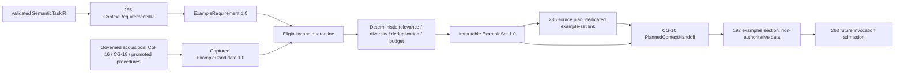

# Dynamic example and few-shot context selection

Historical evidence and removed review documents are linked to their archived Git
revision. They are not current acceptance evidence. Generate fresh reports in an
output directory or retain them as CI artifacts.

Issue [#286](https://github.com/MatthiasBurger-Coder/Cognitive-Gateway/issues/286),
EPIC-05.18. This implements canonical producers and the actual CG-10/#192
handoff. Production provider invocation remains #263 owned. ADR-007/008/015,
[context requirements](context-requirement-planning.md) and the
[Prompt IR boundary](prompt-ir-handoff-boundary.md) retain their authority.



## Ownership and construction

`gateway-domain::example_selection` owns `ExampleRequirement`, `ExampleCandidate`,
`ExampleSet` and `ExampleDecision`. Version 1.0 uses existing `SchemaVersion`,
`ResolvedReference`, `ContentDigest`, `RetrievedFragment`, `Provenance`,
`QualityMetadata`, `CurationState`, `TokenEstimate`, `RetrievalBudget` and
`BudgetUsage`. It does not introduce another trust, provenance, scope or budget
system. Immutable aggregate fields are private. Canonical `to_value()` exports
are output-only contracts, like #285; there is no permissive JSON import bypass.
Any future importer must reconstruct through validating constructors.

1. The trusted #285 host admits task meaning and additional context needs.
   `ExampleRequirement::from_context` returns `None` unless the exact named
   requirement is active and class `Examples`. Optional means beneficial;
   mandatory or active conditional means necessary. Source availability and
   task prose cannot activate examples.
2. The host supplies an explicit `ExamplePolicy`: allowed source subclasses,
   exact optional architecture pin, language/technology/domain tags, minimum
   tag relevance, and explicit cross-scope reuse grants. The task type, target
   kind and output-schema pin come directly from the captured task.
3. Existing acquisition owners supply bounded captured candidate lists. Curated
   and promoted-procedure subclasses map to #285 `Examples`, repository to
   `Repository`, retrieval to `Rag`, and governed experience to `Memory`.
   Requirements must permit these underlying classes and the aggregate
   `Examples` class. This selector never calls retrieval, memory or a model.
4. `select_examples` returns `None` when inactive, otherwise a versioned selection
   result (`ExampleSet`) with possibly zero selected examples, all decisions and
   recomputed usage. Empty optional selections are successful outcomes.
5. `ExampleSet::source()` exposes nonempty sets as one scoped #285 source with
   `ContextSatisfaction::Examples`, exact set digest, merged quality and lineage.
   Add it to `select_context_sources`; pass the same set and authenticated expected
   pin to `ContextCompiler::handoff_planned_context_with_examples`. The ordinary
   handoff remains available for callers without examples.

V1 carries one set for one example requirement per handoff. Multiple independent
example needs must be combined into one explicit requirement by the owning host;
additional mandatory unsatisfied needs continue to block. No persistence, CLI,
service deployment, automatic learning or procedure promotion is introduced.

## Eligibility before ranking

Candidate pins use contract `example`, version 1.0, identity, scope and exact
source revision. Their digest binds captured input/output bytes and metadata,
compatibility and success outcome. Each captured fragment retains its original
source/provenance, quality, evidence, scope and byte digest. Output is optional;
when present it receives the same checks as input. There is no reasoning trace
field: stored demonstrations contain explicit input/output and evidence only.

The host authenticates pins, validation records, freshness, scope policy and
quarantine against its captured sources; retrieved assertions are not proof.
Only `CurationState::Validated` successful demonstrations with a validation pin
with a separate `validated_digest` binding to the exact candidate content are eligible.
The validation record pin retains its own record digest. Pending, failed, rejected,
invalidated, superseded and forgotten examples are unusable. Synthetic/model
origin does not bypass validation. A promoted procedure is only a source class;
CG-24 retains promotion ownership.

CG-20A's authenticated quarantine rejects either the example identity or an
original input/output fragment identity, preventing repackaging. Hostile
instruction-like text not quarantined remains escaped example data; lexical
instructions never grant capabilities or change current task/process/policy.

All selected examples must be fresh, have accepted non-authoritative trust,
no uncertainty or unresolved conflict, satisfy evidence/provenance obligations,
and obey minimum/maximum sensitivity on both halves. Set quality conservatively
merges both halves and all selected candidates, retaining the strongest
sensitivity. Mixed trust must itself be accepted by #285 when aggregating a set.

Cross-project reuse fails closed. An explicit map from the original scope to a
pinned reuse policy in the task scope permits reuse; the host authenticates that
policy. Original scopes remain in each candidate. No fragment scope is rewritten.

Task type, target kind, complete output-schema pin and exact architecture pin
(including absence) are hard compatibility gates. Old output or architecture
revisions cannot win through similarity. Candidate version and byte snapshots
must match; validation must apply to that exact content. Current freshness and
revocation are host responsibilities, never inferred from a wall clock here.

## Ranking, diversity and budgets

The deterministic relevance score is requested tag overlap in thousandths.
No requested tags yields 1000 after all compatibility gates. Below-threshold
candidates are rejected, allowing zero useful matches. Eligible candidates sort
by descending relevance, then uncovered language/technology/domain tags, then
optional advisory score, lower conservative token cost and stable identity.
Diversity is recomputed after each selection. Exact case-normalized input/output
pairs and near duplicates (at least 90% token-set Jaccard overlap) are suppressed.
This deliberately simple baseline is inspectable and provider independent; it
is not a semantic plagiarism detector.

`ExampleRanker` is an optional application port receiving only eligible examples.
Its failure produces the baseline. Extra result IDs have no effect; scores cannot
change eligibility, relevance threshold, hard compatibility or budget bounds.
No concrete provider/embedding implementation is required by this issue.

Count is bounded by `RetrievalBudget.results`; retained pairs charge the
`Knowledge` reservation already used by #285 for `Examples`. The hard token limit
is the minimum of cumulative token limit, context total and that reservation.
No implicit borrowing or truncation occurs. Validated pairs are atomic: CG-20B
may compact other context, but changing an example creates a new candidate
requiring a new snapshot and validation. Counts use `TokenEstimate` exact
counts or conservative upper bounds; unknown, zero and invalid estimates fail
closed. The host must include pair framing in estimates and ensure exact counts
match the eventual target; provider adaptation must revalidate its full envelope.
`ExampleSet::new` recomputes usage and validates CG-20B bounds, independent of
caller totals. Selection itself does no retrieval: rounds, latency and service
cost are zero; acquisition accounting remains with CG-16/CG-18. CG-10/#285 also
checks the shared total budget across task/context/example satisfaction.

## Handoff and authority

The actual CG-10 handoff retains the canonical set under `examples`, adds its
binding to `bindings.examples`, and links planning satisfaction to the same set.
It checks the upstream expected pin, requirement binding, plan selection,
aggregate quality, actual count/tokens and exact satisfaction metadata. A generic
fragment cannot satisfy examples. A metadata-only claim without the canonical
set, an unused nonempty set, or a different set pin fails closed. Missing mandatory
examples block handoff; optional empty sets stay explicit. Examples cannot be
silently stored as evidence, user input, output contracts or stable instructions.

Two offline reference layouts exercise the actual selected set through this
handoff: system/user messages and system/named input blocks. JSON escaping keeps
role delimiters and policy-like text inside data; roundtrip equality proves
metadata and sections survive unchanged. This is producer conformance, not live
provider or installed runtime qualification. #263 must authenticate current
records and authority, apply disclosure and check final provider budgets before
every invocation or fallback. No renderer may fetch or fill missing examples.

`PlannedContextHandoff::example_audit_value` reuses CG-10's authenticated
`ContextDisclosurePolicy`. If external content is excluded or any selected
example exceeds the disclosure sensitivity, the audit section redacts payload
and source-controlled descriptive metadata while retaining identity, quality
and the original set binding. Full immutable invocation data is unchanged.
Redacted audit projections are explicitly marked and cannot be handed back to
the canonical constructor as complete invocation input.

## Acceptance and verification

| ID | Requirement | Owning path and verification |
| --- | --- | --- |
| E01 | Only active #285 example needs activate selection | Domain activation and application no-op tests |
| E02 | Optional zero and mandatory missing | Selector empty results and actual CG-10 denied/allowed paths |
| E03 | Version, source, provenance, scope, trust, validation | Captured fragments, candidate/set digest and exact handoff equality |
| E04 | Invalid/stale/unvalidated/failed/contaminated denied | Domain eligibility matrix and application quarantine proof |
| E05 | Task/output/architecture precede model similarity | Exact compatibility checks and adversarial highest-score test |
| E06 | Diverse, nonredundant selection | Greedy tag diversity, exact/near-duplicate suppression fixtures |
| E07 | Count, conservative tokens, context bounds | Domain constructor and application budget-pressure tests |
| E08 | Inspectable selection/rejection reasons | Every captured candidate receives a pinned decision |
| E09 | Deterministic baseline and optional ranker failure | Reversed-input equality, unavailable adapter and score isolation |
| E10 | Cross-project reuse fails closed | Foreign-scope rejection and explicit pinned-policy acceptance |
| E11 | Canonical set stays separate across actual handoff | Hostile pair through CG-10 and two lossless reference renderings |
| E12 | Documentation, fixtures and >=95% changed-code coverage | This document, Rust fixture suite and release coverage gate |

Run the dedicated gate with:

```sh
cargo llvm-cov -p gateway-domain -p gateway-application -p gateway-context \
  --test example_selection --test context_planning --locked --json \
  --output-path target/example-selection-coverage.json
python3 tests/scripts/check-example-selection-coverage.py --self-test
python3 tests/scripts/check-example-selection-coverage.py target/example-selection-coverage.json
```

The gate checks each new production module and the materially changed CG-10
handoff at >=95% measured lines, without exclusions. Domain and application
fixture tests run offline. Regression qualification also includes existing
#285, CG-10, CGSL, architecture, contracts, formatting and Clippy checks.

The [source-bound acceptance evidence](https://github.com/MatthiasBurger-Coder/Cognitive-Gateway/blob/59f6db7e29478e2903cf69d6e5c7e65632876710/docs/evidence/EPIC-05.18-example-selection.json)
records executed results and the producer/runtime completion boundary. Compressed
coverage and validation logs are retained beside it for review from Git.
