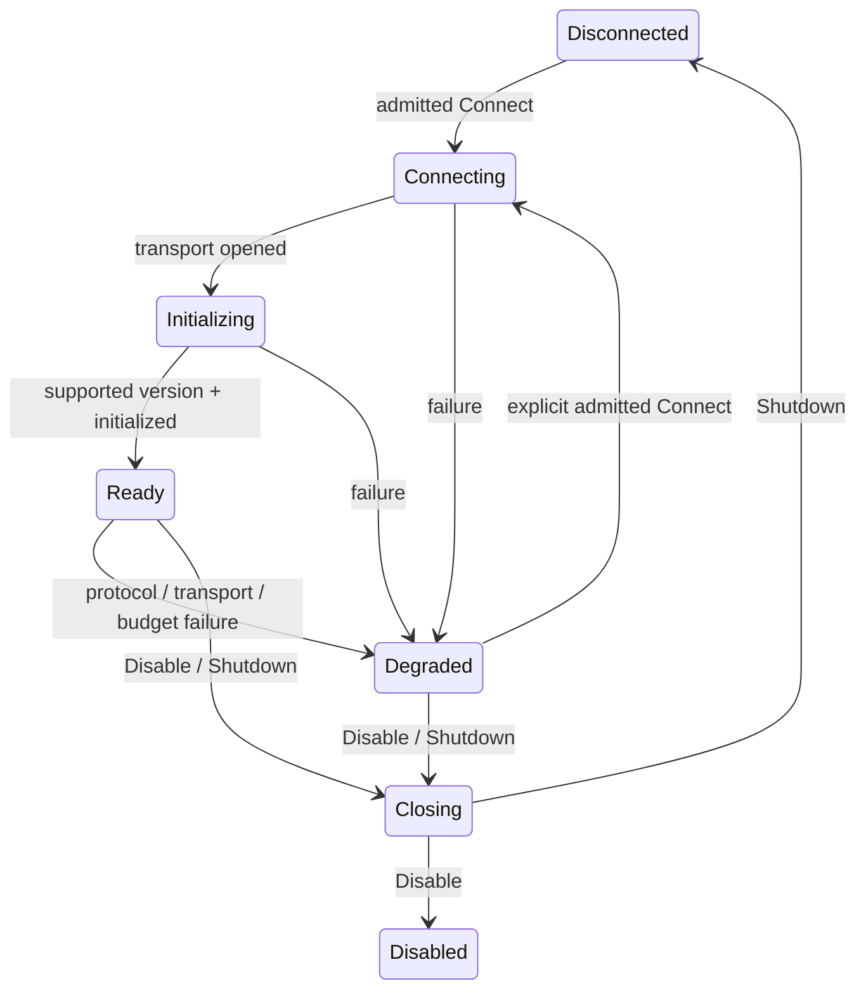

# Outbound MCP client runtime — EPIC-07.03 #226

## Delivered boundary

`gateway_daemon::mcp_client::McpConnectorHost` implements the versioned
`ConnectorApplicationPort`. It owns a **private** `ConnectorRuntimePort`
implementation, session and transport. Construction requires a validated #225
manifest, compatible runtime profile, exact target/scope, configured transport
factory, trusted `ConnectorAdmissionPort`, explicit `ConnectorMapping`, bounded
limits and observer. There is no default authority, identity mapping, normalizer,
raw call endpoint or model-visible transport handle.

The host is an embeddable synchronous application boundary, not a new CLI or an
EPIC-08 coordinator. Call from a blocking worker if the surrounding host uses an
async executor. Production canonical mapping, normalization, credential service
and policy/consent service remain #227/#228/#229/#230. Injected conformance
adapters establish protocol/runtime behavior, not those later integrations.

`ConnectorAdmissionPort` is an additive driving-host authority contract in
connector port v1. `admit_target` checks current admission for lifecycle/discovery
and operations; `authorize` receives the exact canonical request and optional
source; `revalidate` checks the resulting dispatch against current trusted state
immediately before transport. Implementations must validate policy/revision,
consent, task/step/execution, arguments/source, scope, inventory, durable budget
reservation and deadline. Constructing a `ConnectorDispatch` does not grant access.
These checks must be bounded and must not acquire the runtime lock recursively.
No observer or mapping callback may perform blocking work or panic.

## Lifecycle and protocol

The profile pins [MCP 2025-11-25 lifecycle](https://modelcontextprotocol.io/specification/2025-11-25/basic/lifecycle)
and [stdio](https://modelcontextprotocol.io/specification/2025-11-25/basic/transports).
The initialize request advertises no roots, sampling, elicitation or tasks.
The selected protocol version must match exactly. The configured manifest server
version must match `serverInfo.version`; logical server identity/authentication
is not proved by a self-reported name. The initialized notification precedes
ordinary calls. Unsolicited ping requests are answered; other server requests
receive a fixed method-not-found response and cannot invoke host services.

No automatic reconnect or effect retry occurs. A new connection requires explicit
admission and initialization, then complete rediscovery before effects. Shutdown
releases the connection and permits a subsequent admitted Connect. Disable denies
new effects, cancels the active operation and drains for a bounded interval;
backpressure remains explicit if a trusted callback does not return within that
bound. A disabled instance cannot Connect until Shutdown releases it and current
admission allows connection again. Each host owns one target/scope; no sessions
are shared across hosts. Drop kills/reaps the owned subprocess without exporting
its stderr. The adapter owns its direct child; server-managed descendants are
outside the MCP session contract.

`TransportFactory::open` supports starting stdio or attaching a configured custom
transport; no HTTP implementation is enabled by this slice. The stdio adapter
uses Tokio IO solely in the outer daemon. It executes an absolute program in an
absolute working directory, clears inherited environment, applies only explicit
operator environment, bounds reads/writes and suppresses raw stderr. It closes
stdin, waits for a configured grace interval, then kills and waits for its child.
It exchanges UTF-8 newline-delimited frames with a hard byte cap. There is no
unbounded reader queue or blocking pipe worker.

## Discovery and dispatch

Tools, resources, resource templates and prompt metadata are listed only when
the corresponding capability is advertised. Pagination shares the original call
deadline, with page, aggregate item, aggregate inventory byte and per-frame caps.
Duplicate identities, repeated/invalid cursors, malformed entries and partial
pagination fail closed. Entries are sorted before the mapping callback. No
canonical snapshot is published until the complete discovery and mapping pass.
Prompts/templates are inventory only in this slice; there is no prompt execution
or unqualified template expansion.

Before effects the host drains queued protocol notifications. List-change events
invalidate inventory; subsequent dispatch requires rediscovery. A change observed
after a request write still fails the request and preserves effect uncertainty.
Concurrent external changes cannot be made atomic by MCP; the application must
revalidate its canonical revision and policy before dispatch.

Tool calls and resource reads are real `tools/call` and `resources/read` requests.
A mapping cannot substitute admitted typed arguments, switch a resource read into
a tool call, or dispatch an undiscovered tool/URI. The initial qualified JSON
Schema profile supports closed objects containing string, integer and boolean
properties, with required fields and optional descriptive metadata. Unknown
keywords/dialects, open objects, nested values, decimals and sets fail closed.
Structured tool outputs are checked against an advertised output schema under
the same profile. Other schema support requires #227 qualification; it is not
silently approximated. Resource results preserve their exact requested URI and
require text or blob content. Tool `isError` remains explicit in `ProtocolResult`.
Raw bounded content stays with the trusted normalizer; it is never a domain value.
The host checks normalized observation scope, correlation, inventory/source
bindings and CG-06 record validity before returning candidate lineage.

## Budgets, cancellation and diagnostics

One operation per host is admitted; concurrent calls receive typed Backpressure.
`CallContext` carries shared cancellation and a monotonic deadline. The host
narrows it by configured call time and the absolute dispatch deadline, including
sub-second remaining time. Pagination, IO and notification handling never reset
this deadline. Cancellation is polled at most every five milliseconds during IO.
In-flight ordinary requests send [MCP cancellation](https://modelcontextprotocol.io/specification/2025-11-25/basic/utilities/cancellation)
with their numeric request ID; initialization is terminated by disconnecting and
is never cancelled on the wire. Cancellation cleanup has its own fixed shutdown
bound. The failed connection is discarded, so a late response cannot satisfy a
new request. IDs increase across reconnects and never alias within the host.

Errors are typed, deterministic and content-free. Remote error codes are retained;
messages/data are discarded. Observer events include only fixed event/error
kinds, numeric wire IDs and admitted correlation. No arguments, URI, results,
server instructions, environment or credentials are logged. The configured
correlation must match the canonical request. Observer implementations own their
bounded storage/export behavior.

A mutation/admin operation whose write began has `Unknown` effect on any failed
response/normalization, including timeout/cancellation. This runtime never
replays it. Admission owns durable reservation reuse and reconciliation (#230,
#231, EPIC-08); reconnect does not mint reservations or establish retry safety.
Reads report NoMutation after a write; pre-dispatch rejection reports
NotDispatched. Successful provider acknowledgement remains distinct from
independent verification and does not establish task completion.

## Review and traceability

Reviewed as requirement, architecture, automation and test role passes by one
implementing agent; no independent review or approval is claimed. Baseline:
`061fe8ca576139a32ec9c46a837e36266e216627`, clean working tree at intake.
Scope: #226 including its 2026-10-04 dispatch additions; no parent epic closure.
The readiness decision was READY_FOR_WORKFLOW for this protocol slice, with
trusted admission/mapping/normalization as required extension ports rather than
permissive substitutes for the dependent implementations. The recorded delivery
boundary excludes installed provider and full policy qualification.

| ID | Requirement/source | Production owner | Dependency state | Verification/evidence level | Status |
| --- | --- | --- | --- | --- | --- |
| R01 | Connect/negotiate/version rejection | private Session, StdioConfig | #225 validated manifest implemented | Independent subprocess handshake/version tests | VERIFIED at component/runtime boundary; see evidence report |
| R02 | Explicit state, health, shutdown/reconnect | Session + application host | No implicit retries | State/event assertions and fresh inventory after reconnect | VERIFIED at component/runtime boundary; see evidence report |
| R03 | Tools/resources/templates/prompts discovery | Session | Canonical mapping #227 remains separate | Optional capability, pagination, duplicates, limits fixtures | VERIFIED at component/runtime boundary; see evidence report |
| R04 | Cancellation/deadline/correlation | CallContext, transport, host | Uses admitted absolute deadline; no new budget authority | Real delayed peer, cancellation, backpressure and unknown effect tests | VERIFIED at component/runtime boundary; see evidence report |
| R05 | Deterministic protocol errors/observability | Error, Event, strict JSON decoder | No provider rules | Invalid JSON/IDs/remote errors/server requests/flood fixtures | VERIFIED at component/runtime boundary; see evidence report |
| R06 | Actual bounded tool/resource dispatch | private runtime + mapping port | Explicit scalar schema profile; no automatic mappings | Real tools/call and resources/read through driving port | VERIFIED at component/runtime boundary; see evidence report |
| R07 | Only authorized host can dispatch | private Runtime + required admission port | Full current CG-09 policy service #230 pending | Denial/revalidation/tampered request/scope tests and privacy compile-fail test | VERIFIED at component/runtime boundary; see evidence report |

Run the focused qualification and the per-file coverage gate with the commands
in `scripts/quality-gates.json` (EPIC-07.03). Retained results and source bindings
are in `docs/evidence/EPIC-07.03-runtime.json`. They qualify the library/runtime
candidate and synthetic server, not live external effects or EPIC-07 completion.
