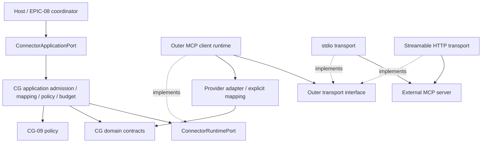

# MCP Connector and Plugin Runtime

## Status and scope

**Normative architecture and compilable port foundation — EPIC-07.01 #224.**
The [protocol runtime and stdio transport](mcp-client-runtime.md) are implemented
under EPIC-07.03 #226 behind a required admitted application host.
[Canonical mapping](connector-mapping-v1.md) is implemented under EPIC-07.04 #227.
Canonical result normalization is implemented by #228. Credential profile references, runtime secret resolution contracts, scoped environment binding and authentication failure typing are implemented under #229. #369 adds a CG-09-backed connector admission component; durable trusted policy/consent source composition and installed-path qualification remain incomplete under #230/#274. Live reference connectors remain planned under EPIC-07 #223. ADR-022 records ownership; ADR-016 separates inbound Codex MCP
(EPIC-04) from outbound CG → external systems (EPIC-07).

MCP supplies protocol plumbing. CG owns planning, process legality, policy,
authorization, consent, scope, evidence trust and context selection. Discovery
never grants permission. An authenticated source is not automatically trusted.

## Component and dependency boundaries



Arrows describe source dependencies, except the two external-server edges.
`gateway-domain` depends only on approved serialization/hash libraries;
`gateway-application` owns the provider-neutral ports and depends on existing
inner services. Outer implementations are composed by `gateway-daemon`.
Neither inner crate imports the daemon or a provider/protocol/transport SDK.
Provider mapping and transport are siblings beneath the runtime, with no reverse
edge into runtime orchestration. No new crate or duplicate policy/planner is
required. The Cargo dependency guard checks normal, dev, build and target edges
and rejects cycles, aliases hiding SDKs and substituted workspace sources.

| Responsibility | CG deterministic domain/application | Outer MCP runtime | Provider adapter / transport |
| --- | --- | --- | --- |
| Task, step, process, plan, policy, consent | Sole authority; revalidate before effects | Enforce application binding, no new grants | No authority |
| Scope/server admission | Own allowed instances and project/request isolation | Separate sessions by admitted scope/identity | Resolve configured endpoint only |
| Discovery | Validate and inspect derived inventory; never mutate canonical catalogs | Initialize, paginate within limits, collect tools/resources/prompts | Translate wire schemas, IDs and metadata |
| Capability classification | Own explicit versioned mapping and conflict rejection | Bind inventory revision to dispatch | Supply candidate mapping; annotations are hints |
| Tool invocation/resource access | Validate typed arguments, capability, scope, policy and budgets | Perform tools/call or resources/read | Render/parse provider representation |
| Lifecycle | Own enable/disable and allowed retry decisions | Connect/negotiate/health/cancel/shutdown, bounded queues | Process/HTTP/socket mechanics |
| Evidence/context | Own CG-06 validation, quality, sufficiency, CG-10 minimization | Preserve correlated acquisition metadata | Normalize payload into candidate lineage |
| Credentials | Opaque profile association; no secret values or serialization | Resolve at connection time; isolate; reload on reconnect | Inject only narrowly named secret environment variables; provider authentication |
| Diagnostics | Stable content-free failure/effect records | Correlate and bound protocol errors | Redact raw errors before any export |
| Aggregate execution | EPIC-08 owns session persistence and aggregate budgets | Consume existing reservation; never reset on reconnect/retry | Report usage/effect uncertainty |

## Versioned port/adapter contracts

The public Rust surface is
[`gateway_application::connectors`](../crates/gateway-application/src/connectors.rs),
revision `CONNECTOR_PORT_VERSION = "2"`. Inbound and outbound port modules
re-export the driving/driven traits. This is an in-process architecture contract,
not a serialized manifest or an authorization token format. Breaking changes
require a new revision and consumer migration. #225 owns the full identity,
manifest, compatibility and configuration format, now defined in the
[manifest v1 contract](connector-manifest-v1.md); its fields elaborate
these instance/scope and inventory bindings without adding provider types.

| Port | Methods | Preconditions and result |
| --- | --- | --- |
| Driving `ConnectorApplicationPort` | `discover`, `invoke`, `read_resource`, `lifecycle` | Host supplies admitted scope; application validates proposals and obtains current authorization before calling runtime |
| Driven `ConnectorRuntimePort` | `discover`, `invoke`, `read_resource`, `lifecycle` | Outer runtime accepts canonical requests/dispatch, returns bounded inventories, candidate observations, lifecycle states or typed failures |
| Existing CG-06 `ObservationEvidenceInputPort` | `ingest_observations` | Application validates normalized lineage and scope before ingestion; connectors never write state directly |

`ConnectorTarget` identifies one configured instance and explicit `ContextScopeId`;
provider/server versions and transport/session IDs stay in outer configuration.
`ConnectorInventory` is sorted by canonical capability ID and source ID, contains
no duplicates, and is published atomically only after bounded complete discovery.
Its digest binds connector identity, manifest revision, negotiated protocol,
wire tool/resource schemas and canonical mappings, using a versioned canonical
encoding owned by #225/#227. Partial pagination, duplicate/conflicting mappings,
unknown classes and unsupported schemas fail closed; no usable partial index is
published. Inventory notifications invalidate the snapshot; they grant no access.
Discovery of prompts is inspectable metadata, not permission to execute prompts
or send them into CG-10.

`ConnectorRequest` carries canonical capability, operation class, typed arguments,
exact inventory digest, scope, task, step, execution and correlation. Argument and
result schema digests belong to each mapped capability. Resources use canonical
`SourceId` plus the same request binding, with no arbitrary wire URI escape.
The application must bind the resource ID to the evaluated arguments, capability
and target; changing it requires reevaluation. Adapter-owned mapping resolves
canonical IDs to wire tool names/resource URIs. Schema validation rejects unknown,
ambiguous or unsupported argument shapes; raw provider JSON is not a domain value.
The MCP host exposes complete mapped tool schemas only for the exact current
target and inventory revision. Invocation `ToolDefinition`s pin that target,
revision and executable argument-schema digest; the application accepts only
the closed scalar/object schema subset and rejects mismatches before proposal
dispatch. Documentation-only schema fields do not change the executable-schema
digest, while the full inventory revision still binds them and detects any
discovery drift.

`ConnectorDispatch` additionally binds current policy ID/revision, required consent
receipt, a durable aggregate budget reservation and deadline. The application
checks all these against trusted current state immediately before dispatch,
including request/argument/resource digest and target/inventory revision. Missing,
expired, revoked, reused or mismatched bindings deny dispatch. Public Rust records
are inspectable data and are constructible; their type does **not** prove a grant.
#230 must implement this validation and prevent callers bypassing the application.
The daemon wires runtime access privately behind the application service.
Models submit proposals only and never receive credentials or runtime handles.

Every call is bounded by configured inventory/page/schema/payload sizes, deadline,
concurrency and queue capacity. The synchronous Rust interface does not prescribe
threads, async executor, process handles, sockets or HTTP clients. Lifecycle
`Disable` denies new work and cancels/drains in-flight work within a bound;
`Shutdown` releases sessions/processes. Disabling or closing a scope invalidates
associated handles; reconnect requires admission and fresh compatibility/inventory
checks. Cancellation and reconnect do not erase effect uncertainty or accounting.
The runtime retains request correlation for cancellation while calls are active;
#226/#231 implement that internal control mechanism, outside the domain API.

Session-bound calls retain the original cancellation token and deadline while
polling current CG-09 and resource admission. The policy source's current
lookups are bounded and read-only; audit decisions belong to explicit
authorization and pre-effect revalidation. Reserved connector discovery also
checks current target admission during negotiation and inventory reads.

Inventory notification polling separates the short wait deadline from the
active operation context. Complete buffered frames are drained even when the
wait deadline expires; actual cancellation, deadline and authority still apply.
Alternative transports must explicitly implement
`Transport::receive_with_wait_deadline`; the default refuses unsupported
polling. A consumed invalidation cannot be discarded as an idle-poll timeout.
Discovery failures after attempted handshake/list I/O retain `NoMutation`;
an early denial before any send attempt remains `NotDispatched`.

## Operation and authority classes

| Connector class | Existing `CapabilityClass` | Required authority |
| --- | --- | --- |
| READ | Inspect | Current scoped read policy; consent where required |
| SEARCH | Inspect | Scoped query and result disclosure policy; bounded search |
| INSPECT | Inspect | Current inspection policy; no external mutation |
| MUTATE | Mutate | Explicit CG-09 effect authorization, consent where required, retry safety |
| ADMIN | Mutate | Explicit administrative capability and policy; never inferred from ordinary mutation permission |

CG owns the mapping. `readOnlyHint`, tool names or a provider's reported
permissions cannot classify or authorize operations by themselves. Unknown or
conflicting mappings have no executable representation. READ/SEARCH/INSPECT may
still expose sensitive information and always pass policy. ADMIN is a separate
operation class checked together with capability identity even though existing
CG-09 uses the broader Mutate class. No changes to that domain enum are needed.

## MCP compatibility baseline and extension policy

This architecture pins **MCP 2025-11-25**, JSON-RPC 2.0; this is the implemented outbound protocol
profile. It does not change EPIC-04's existing inbound version. The bounded
scalar schema profile and runtime qualification are documented in the
[client runtime contract](mcp-client-runtime.md). The versioned [MCP specification](https://modelcontextprotocol.io/specification/2025-11-25),
[lifecycle](https://modelcontextprotocol.io/specification/2025-11-25/basic/lifecycle)
and [transports](https://modelcontextprotocol.io/specification/2025-11-25/basic/transports)
are the protocol authority (reviewed 2026-10-24).

| Surface | Initial supported profile / required behavior |
| --- | --- |
| Negotiation | `initialize`, exact allowlisted version check, then `notifications/initialized`; no ordinary operation before readiness |
| Tools | `tools/list`, `tools/call`, negotiated server tools capability; schema validation and explicit canonical mapping |
| Resources | `resources/list`, `resources/templates/list` where advertised, `resources/read`; template expansion constrained by admitted mapping |
| Prompts | Inventory only where advertised; no prompt execution in the initial profile |
| Utilities | Ping, bounded notifications/progress, cancellation and redacted diagnostics; notifications grant no authority |
| Client features | Do not advertise sampling, elicitation or roots; unsolicited server requests cannot access models, files, credentials or users |
| Optional features | Tasks, subscriptions, experimental capabilities and provider extensions disabled until explicitly admitted and qualified |
| stdio | First production transport target for #226; subprocess/env/termination and framing owned by outer runtime |
| Streamable HTTP | Replaceable second transport boundary; implementation/qualification required before enabling; no automatic legacy HTTP+SSE fallback |

The initialize response must select an explicitly supported version; unsupported
versions terminate the session as `IncompatibleVersion`. There is no silent
upgrade, downgrade or "latest" dependency. An additional version, transport,
schema dialect or extension needs an explicit compatibility record, bounded
canonical translation and conformance tests, including denial paths. Unknown
optional metadata may be ignored if the baseline permits it; unknown required
semantics fail closed. No extension may broaden scope, policy or evidence trust.
Legacy HTTP+SSE and custom sockets are outside this initial profile.

The outer transport interface exchanges bounded protocol frames/events and
supports open/send/receive/cancel/close under a deadline. JSON-RPC IDs, framing,
HTTP status/headers/session IDs, SSE, TLS, OAuth, subprocess handles and environment
variables stay entirely there. Both transports implement the same runtime port;
changing transport does not change a domain or application request.

## Evidence and data flow

```mermaid
sequenceDiagram
    participant H as Host / coordinator
    participant A as CG application
    participant P as CG-09 / budget authority
    participant R as Outer MCP runtime
    participant S as External server
    participant E as CG-06 ingestion
    participant C as EPIC-02 / CG-10
    H->>A: Scoped typed operation proposal
    A->>P: Evaluate capability, class, arguments, consent, inventory
    P-->>A: Current decision + budget reservation
    A->>R: Bound ConnectorDispatch
    R->>S: Mapped tools/call or resources/read
    S-->>R: External payload / acknowledgement
    R-->>A: Candidate lineage + acquisition + effect/failure
    A->>A: Validate correlation, schemas, scope, provenance and quality
    A->>E: ScopedObservationBatch
    E-->>C: Admitted evidence via existing retrieval boundary
    C-->>H: Minimized context; no credentials
```

`ConnectorObservation` reuses CG-06 `ObservationEvidenceSet`, `SourceId`,
`SourceTimestamp`, `ContentDigest` and `UnixTimestamp`; it does not invent another
Evidence or ContextFragment. It binds instance, scope, inventory revision and
correlation, plus source revision when available, content digest and acquisition
time. #228 implements [canonical result normalization](connector-result-v1.md) and
preserves object identity in existing provenance/source references. Port revision 2
requires its correlation, acquisition, handling and effect metadata. Unknown source revision stays absent;
local acquisition time must never masquerade as provider revision.

Application admission validates lineage, result schemas, scope/correlation and
source mappings, then constructs existing `SourceSnapshot` and
`ScopedObservationBatch`. CG-owned rules attach `QualityMetadata` (trust,
sensitivity, freshness, uncertainty/conflict); provider claims cannot upgrade
these. The existing `ObservationEvidenceInputPort` ingests the batch. EPIC-02
retrieval/ContextFragment and CG-10 select and minimize the admitted evidence.
Untrusted instructions inside payloads remain content; they cannot change policy,
plans, processes or catalog definitions. Credentials must never appear in
arguments, evidence, context, model-visible results or diagnostics. Outer redaction
and application disclosure checks must precede persistence or model exposure.

`ProviderAcknowledgement` is not independently verified completion. `SourceRead`
is an ordinary acquisition. `IndependentPostEffectRead` requires a separate
admitted read-back and evidence linkage to the expected effect; the enum label
alone proves nothing. Model explanation is never connector evidence. CG-14 and
EPIC-08 retain responsibility for verification/completion and session persistence.

## Failure ownership and diagnostic boundary

`ConnectorFailure` has only stable code, effect state and correlation; it has no
raw provider message/payload/URL. Detailed outer logs must be bounded and redacted
before recording; protocol/server logs are untrusted. Failure does not mutate
planner, process, registry or policy state.

| Failure | Detecting owner | CG action |
| --- | --- | --- |
| Unavailable, protocol/version/schema error | Runtime / mapper | Fail closed; no malformed result ingestion |
| Authentication failure | Outer credential/provider adapter | Narrow or repair credentials outside core; no guessed retry |
| Permission/scope/inventory mismatch | Application; runtime may additionally deny | Deny; reevaluate current authority/inventory |
| Timeout/cancel/rate limit/backpressure/budget exhaustion | Runtime / application accounting | Preserve effect state; apply bounded CG retry policy |
| Stale/conflicting result | CG evidence admission | Retain provenance/conflict; no trust upgrade or silent overwrite |
| Mutation uncertain / retry unsafe | Runtime reports ambiguity; CG decides recovery | Block repeat effects until safe reconciliation |

`NotDispatched` means no request was sent. `NoMutation` is usable only for an
admitted non-mutating class. `Acknowledged` is provider acknowledgement, not
verification. After a possible MUTATE/ADMIN send, timeout, cancellation, crash or
lost response yields `Unknown`, including protocol/schema failure after sending.
A failure code must never erase this state. An invalid code/effect combination is
itself rejected conservatively as unknown if an effect could have been dispatched.

The application may retry reads within policy and remaining aggregate budgets.
Mutations require explicit retry safety from admitted operation metadata;
#225/#227 define provider idempotency and read-back metadata, #231 implements
bounded reconciliation. Repeating a request ID, reconnecting or a model claiming
"safe" proves no idempotency. If a post-effect observation cannot resolve the
outcome, the mutation remains blocked/unknown. EPIC-08 #277 owns aggregate
limits; every attempt/reconciliation consumes the existing ledger without resets.

## Forbidden coupling examples

- `ConnectorRequest { github: octocrab::Issue }`: provider SDK in a core port.
  Use typed canonical arguments and source/provenance references.
- `ContextFragment { token: github_pat }`: credential disclosure. Resolve secrets
  only at the outer authentication boundary, then check result disclosure.
- Planner calls `tools/call`, reads HTTP headers or handles subprocess IDs:
  protocol/transport leakage. Call the application port instead.
- Register every discovered tool as a canonical capability or trust `readOnlyHint`:
  discovery laundering. Require explicit mapping and current policy.
- Adapter writes Process/Policy/catalog state or marks a goal complete after a
  successful HTTP response: authority inversion. Return candidate observations.
- Resource URI supplied outside the authorized argument/resource binding:
  scope escape. Resolve an admitted canonical source under the evaluated request.
- Retry `issue.comment` after timeout as if it were a read: possible duplicate
  effect. Preserve unknown outcome and reconcile using admitted metadata.
- Inbound Codex credential forwarded to an external server, or EPIC-06 model
  adapter used as a connector: plane/credential conflation. Keep distinct ports.

## Qualification and delivery boundary

#224 delivers types/traits, architecture and compile/dependency evidence only.
There is no executable authorization/normalization/runtime logic here, so runtime
coverage is not claimed. Subsequent implementations require applicable >=95%
coverage and failure/security tests. The contract integration test compiles two
independent synthetic runtime implementations and a driving service against the
same port; it establishes interface replaceability, not real protocol compliance.

| ID / #224 criterion | Contract / authority | Evidence for this slice |
| --- | --- | --- |
| C01 Provider-free deterministic core | Canonical request/observation types; ADR-022 | SDK boundary test and Cargo dependency guard |
| C02 Isolated MCP protocol | Application/runtime ports; ADR-016/022 | Wire-type boundary test and contract compilation |
| C03 CG owns planning, policy, trust, authorization | Dispatch preconditions; existing CG-09/CG-06/CG-10; `Cg09ConnectorAdmission` component | #369 component tests exercise policy mapping/revalidation; installed trusted source composition and end-to-end enforcement remain #230/#274 |
| C04 Replaceable transport | No wire types in public ports | Two independent synthetic implementations compile |
| C05 Read/mutate authority separation | Five classes mapped onto existing Inspect/Mutate | Typed request compilation and normative operation table |
| C06 Acyclic architecture | Existing workspace DAG, outer composition root | Cargo metadata graph and cycle rejection tests |
| C07 Forbidden coupling documented | Negative examples above | ADR checklist and hidden-dependency mutation tests |

Review checklist (single-agent architecture review; no external approval implied):

- [x] No mandatory provider-specific type or protocol SDK enters core contracts.
- [x] Driving/driven discovery, invocation, resource and lifecycle ports are explicit.
- [x] CG retains policy, scope, consent, planning, trust and completion authority.
- [x] MCP version/optional feature/transport admission is explicit and fail closed.
- [x] Inventory, authorization, arguments, resources and budget bindings are defined.
- [x] Failure diagnostics preserve uncertain effects and prohibit blind mutation retry.
- [x] Dependency/data-flow diagrams and forbidden examples are reviewable in Git.
- [x] Later runtime enforcement and live qualification are explicitly distinguished.

Run `cargo test -p gateway-application --test connectors --locked`,
`python3 -m unittest discover -s tests/architecture -p 'test_*connect*.py'`,
`bash scripts/check-architecture.sh`, `cargo fmt --check` and the existing quality
gates. The evidence record is [EPIC-07.01](evidence/EPIC-07.01-architecture.json).
#225 can build the manifest foundation; #226–#232 implement these boundaries;
#233/#234 prove GitHub and independent adapters; #235 owns end-to-end/live effects.
No parent-epic completion or real connector availability is implied by this slice.

### Operator credential file

`mcp_client::credential_file::CredentialFileResolver` implements the existing
`ConnectorSecretResolver` for a separate absolute operator secret-file path.
It is an installable adapter; its existence does not install a local connector
runtime or grant a policy, session, transport, or tool permission. The file is
not part of main admission. Its version 1 JSON shape is:

```json
{"schema_version":1,"profiles":{"records-reader":{"connector":"records","server":"records-peer","tools":["records.read"],"generation":1,"environment":{"API_TOKEN":"operator-supplied-secret"}}}}
```

Profile IDs select exactly one profile, with no fallback. The whole document is
validated on each resolution, so an invalid unrelated profile also refuses the
lookup. Connector, server and wire tool names form the native credential scope; an empty tool list permits no
tools. Wildcards, duplicate names/keys, unknown fields and invalid credential
environment keys are refused. The file is limited to 65,536 bytes and JSON depth
64, with at most 32 profiles, 32 environment entries per profile and 128 tools
per profile. Names are at most 128 UTF-8 bytes; nonempty secret values are at
most 8,192 bytes and cannot contain NUL. Generation is an unsigned 64-bit value.

Every resolution rereads the file. Install rotations atomically; a malformed or
missing file/profile fails closed with a content-free typed error. The existing
`CredentialedStdioFactory` resolves on reconnect and retains that connection's
scope and secrets until closure. Updating this file does not revoke an already
open connection. Resolver and resolved credential material have no Debug or
serialization output and must stay within the outer adapter.

### Canonical acquisition quality

`AcquisitionPort` supplies mandatory host-assessed `confidence` and `uncertainty`
under the authenticated source contract. Unassessed collectors retain `Unknown`;
`partial: false` never establishes certainty. A qualified deterministic complete
source reader may explicitly supply `Confidence::NotApplicable` and
`Uncertainty::None` when its actual pinned source contract establishes that
assessment. Partial reads always normalize to `Uncertainty::Incomplete`, even
when the collector supplied `None`. Provider JSON cannot supply these assessments,
trust, sensitivity, timestamps or conflict handling. The same resulting quality
is retained in the normalized observation, subject metadata and context fragments.

### Qualified scalar acquisition accounting

The internal `scalar_quotes::qualified_scalar_host` constructor seals the actual
scalar normalizers, discovery mapper and MCP host limits into one host/quote pair.
It retains the exact opaque allocation view from `SessionConnectorRun::with_factory`;
pricing and result validation refuse even another genuine child allocation.
The opaque bundle is consumed as a whole by `SessionConnectorComponents::from_qualified`;
production callers cannot replace its host and quote parts independently. Its
read-only metadata witness retains the native mapped snapshot produced by actual
budgeted discovery and requires the complete returned inventory summary to match.
This is historically checked data, not current dispatch authority. Tool-schema
access checks the current host inventory without transport I/O. The witness owns
only a weak host reference and becomes unavailable after the run releases it.
A copied profile or arbitrary normalizer cannot establish its bound. Unqualified
collectors are refused. A qualified collector explicitly guarantees bounded,
read-only host metadata acquisition, no provider/model/embedding operations and
no secret material; the source also validates response object membership before
scalar normalization. These are trusted source implementation contracts.

Every logical operation reserves its full quote, with no refund on denial or
failure. Request accounting includes the canonical native typed arguments,
including all keys, selectors and query strings, plus every normalized fact value.
The scalar normalizer admits at most 262144 canonical input JSON bytes and 256
unique fields. Native scalar `TypedValue` serialization adds at most 32 bytes per
field to its original JSON value, yielding a pre-dispatch output ceiling of
`262144 + 32 * fields`. The native `TokenEstimate::Estimated` carries an explicit
conservative UTF8-byte upper bound and estimator semantics. This does not redefine
all retrieval tokens as bytes or assert an exact model tokenizer count. Repeated
inputs are charged on each operation. This direct local path performs no
embedding work; adding embedding or external billing needs a qualified additional
bound. Discovery accounts its canonical application inventory and empty input,
bounded by the exact loaded mapping. Wire frames, pagination and notifications
retain the host's independent bounds.

Pricing requires an explicit operator fixed local tariff in an immutable cost
unit; stdio alone never proves zero cost. Existing numeric quote declarations do
not prove this tariff or the scalar bound. Full observation persistence limits,
collector metadata bounds, and whole model context/window budgets remain separate
requirements. Post-result validation checks the pre-established bound and cannot
establish a hard ceiling retrospectively.

### Connector resilience

[Connector resilience v1](connector-resilience-v1.md) defines the EPIC-07.08
retry engine, provider recovery metadata, shared deadlines and aggregate spending,
rate-limit profile, host circuit breaker, backpressure and content-free health
events. Component qualification uses the real independent stdio peer; live
provider qualification remains the separate EPIC-07.12 boundary.
