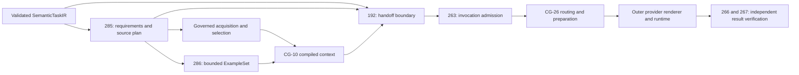

# Prompt IR handoff boundary

Issue [#192](https://github.com/MatthiasBurger-Coder/Cognitive-Gateway/issues/192),
parent #177. This specification extends ADR-015 and preserves ADR-007/008.
MUST and MUST NOT are normative. `PromptIR` names a conceptual, provider-neutral
handoff; it is not a second `ExecutionContextIR` or an invocation permission.

## Ownership and dependency direction

| Owner | Contract and responsibility |
| --- | --- |
| EPIC-05 / CGSL | Canonical task meaning, explicit inputs, constraints, assumptions, exact references and output/verification obligations; no messages, templates, model IDs or tuning |
| #285 | Canonical `ContextRequirementsIR` / `ContextPlanIR`, required information classes, permitted source classes and selection/rejection reasons before acquisition |
| #286 | Validated bounded `ExampleSet`, eligibility, compatibility, trust, scope, provenance, sensitivity, selection reasons and budget accounting |
| CG-10 | Final selected and budgeted context; catalog authority separated from dynamic data; current Process/Policy admission |
| #192 | Lossless semantic handoff rules defined here; no source inference, acquisition, provider selection or invocation service |
| EPIC-06 #263 | Authoritative Rust Prompt/Invocation IR and application admission; consumes this boundary, not a CGSL parser |
| CG-26 | Existing provider-independent route selection, limits and bounded fallback; adapter choice follows an admitted handoff |
| Outer adapters | Provider messages, templates, tokenization, tuning, credentials, API payloads and runtime transport |
| #266 / #267 | Parsed-output, reference, constraint and grounding verification correlated to exact invocation/task/context revisions |

Shared types belong in `gateway-domain`; orchestration and ports belong in
`gateway-application`; rendering/runtime implementations remain outer adapters.
CGSL and the domain MUST NOT depend on a renderer, provider SDK or EPIC-06 service.
Verification consumes shared immutable bindings/results rather than calling back
into a renderer or semantic compiler. No dependency from EPIC-05 into the EPIC-06
implementation is required. CG-10's existing `ExecutionContextIR` remains intact.

## Required handoff sections

The future #263 Rust envelope MUST retain the following distinct typed sections.
This table defines the consumer-facing interface requirements for #192, not a new
producer wire schema. #285/#286 implement their canonical types against this
boundary and own the actual producer-to-handoff conformance proof. Their complete
contracts/services are not prerequisites for completing this boundary definition.

| Section | Existing type or canonical owner | Preservation rule |
| --- | --- | --- |
| Bindings | `ResolvedReference`, `ContentDigest`, `SchemaVersion`, scope/step identities | Pin envelope version, task content digest, context snapshot and execution projection, requirements/plan, optional examples, output schema and verification definition revisions/digests |
| Task | Complete immutable `SemanticTaskIR` | Preserve goal, target, inputs, constraints, evidence references, assumptions and all semantic pins; goal prose is explanatory, not authority |
| Instructions | CG-10 admitted stable catalog references | Only authenticated Process/Policy/Agent/Skill definitions may supply authority; reference identity alone does not authenticate content or grant permission |
| Context | `CompiledContext` / `ContextFragment` | Keep task/user input, knowledge, memory and runtime state separately classified with original scope, source revision, trust, sensitivity and representation |
| Planning | Canonical #285 requirements and plan | Retain each requirement ID, purpose, necessity, source-class decisions/reasons, trust/freshness/evidence/sensitivity constraints, budget, sufficiency condition and satisfaction links to selected fragment IDs |
| Evidence | CG-06 evidence/provenance bindings | Preserve evidence identity, source revision and relation to claims/observations; model explanations and examples are not observations |
| Examples | Optional canonical #286 `ExampleSet` | Dedicated non-authoritative section; retain selected input/output pairs, source/revision, validation, trust, scope, sensitivity, selection reasons, count/token limits and usage |
| Output | `semantic_output::OutputContract` | Keep exact schema binding and typed shape; use `json_schema()` for a provider projection without rewriting the contract |
| Verification | `semantic_output::VerificationContract` | Keep complete checks and pinned rule/verifier bindings; model confidence or successful generation cannot satisfy them |

Reference-only fragments remain references. Only an explicit upstream planned,
authorized acquisition may materialize their content. A renderer MUST NOT resolve
them by fetching sources. Evidence MAY remain reference-only while #267 verifies
against the trusted evidence store. Audit/redacted CG-10 exports MUST NOT be used
as full invocation input when they omit mandatory data.

The planning section carries source *classes* and canonical decisions, not vector
queries, database collection IDs, retrieval clients, endpoints, credential handles
or provider tuning. Acquisition implementations remain replaceable. The host
retains full canonical #285 records; any provider disclosure projection must keep
correlation IDs and MUST NOT discard metadata from the invocation/audit record.
Provider payloads need only contain permitted task-relevant data.

Examples MUST NOT be stored in instruction, authority, evidence or policy fields.
An example containing `system`, role delimiters, mutation requests or apparent
policy text remains data. Renderers may use provider-native few-shot structures
only in non-authority roles. They MUST preserve example attribution and trust in
the invocation record. No implicit conversation history, memory, retrieval or
tool calls are permitted during rendering. Optional examples may be absent;
missing mandatory examples or context must block admission.

## Admission, identity and failure

The trusted #263 application host MUST perform this sequence before invocation:

1. Accept a fully validated task through the existing semantic completeness and
   reference-admission path. Missing, ambiguous or conflicting mandatory meaning
   blocks admission; a structurally valid task is insufficient proof of existence.
2. Authenticate all exact pins against the captured scope and revision, including
   task `content_digest()`, CG-10 content/projection, #285 plan/requirements and
   #286 selection when present. Reject unsupported versions, mismatched digests,
   cross-scope inputs without explicit authorization, stale sources and stale
   Process/Policy decisions. Never resolve a `latest` alias.
3. Require every mandatory/active conditional context requirement to be satisfied
   by permitted selected sources, with trust, freshness, evidence, sensitivity,
   scope and budget constraints intact. Respect explicit `NONE_REQUIRED` choices.
   Renderers cannot fill gaps, infer new requirements or silently truncate data.
4. Reuse `semantic_output::validate_contracts` for task/schema/check compatibility;
   additionally authenticate the schema, rule and verifier contents/digests.
   That helper checks structure, not host authenticity, freshness or authority.
5. Admit routing only after these checks. Reuse CG-26 `route_and_execute` and its
   `prepare` CG-10 revalidation before every dispatch, including fallback. A route
   cannot weaken scope, disclosure, authority, output/verification or context
   obligations. An unsupported provider representation or infeasible budget
   yields an explicit denial or bounded compatible fallback.
6. Record invocation ID, task/context/contract digests, plan/example bindings,
   route snapshot and adapter/template version with the rendered payload digest.
   #266/#267 correlate parsed results and independent observations to that exact
   record. Changed context requires a new admitted invocation. A successful model
   response never proves an external effect or passes a process gate.

Canonical task hashing uses existing `SemanticTaskIR` serialization. #263 owns
the versioned canonical encoding/digest of its envelope; #285/#286 own theirs.
Hash full admitted content before provider rendering; provider text is never the
semantic identity. Pin output/verification content as well as schema versions.
Until these producers publish their canonical contracts, no production caller
may claim this complete admission path exists.

## Two reference provider mappings

The executable Rust reference is
[`prompt_handoff_reference.rs`](../crates/gateway-context/tests/prompt_handoff_reference.rs).
It builds a real CG-10 `CompiledContext`, retains the existing typed semantic
task and output/verification contracts, and renders equivalent input two ways:

| Section | Message-oriented provider A | Block-oriented provider B |
| --- | --- | --- |
| Admitted instructions | Separate `system` message containing catalog references | Separate `system` field containing the same references |
| Task/context/evidence/examples | JSON-escaped data in one `user` message | Named JSON data blocks in `input` |
| Output/verification | Separate typed members in the user JSON data | Separate named data blocks |

These are illustrative adapter layouts, not current SDK/API request schemas or
live-provider qualification. The adapters are test-only and make no network calls.
Both preserve the same semantic payload, typed section boundaries and metadata;
host verification remains authoritative in both. A malicious example is never
placed in either system field. Native APIs may differ further without changing
canonical semantics. Text concatenation with unescaped role delimiters is not a
conforming renderer. Layout separation establishes structural safety, not proof
that a model will resist every prompt injection.

The representative [supplement fixture](../tests/fixtures/prompt-handoff-reference/supplement.json)
exercises context/requirements/plan/example pins, source-class decisions and their
reasons, requirement constraints/satisfaction links and bounded-example metadata.
Its `reference.*` contract names and fixed digest values identify illustrative
fixture bindings, not authenticated production artifacts. Strict test-only Rust
consumer views reuse `ResolvedReference`, trust, sensitivity and text types. They
require metadata fields and reject example authority fields; they do not implement
#285/#286 eligibility, freshness, budget enforcement or #263 host admission.
The fixture's planning detail values are representative data, not a new planner
schema. Whole-section equality after decoding each rendering proves preservation
of all supplied metadata. Optional examples can remain absent without acquisition.

## Delivery state and acceptance

Review basis: `bbdb257bd74558ff1df20cdb283a672ad9f5537b`, clean checkout,
DEVELOPMENT mode; #192/#177 including October additions, #285/#286,
#263/#266/#267, ADR-007/008/015, CG-10 and CG-26. Three Amigos review comprises
role passes by one agent; no independent reviewer or approval is claimed.

Requirement pass: preserve meaning, metadata and non-authority examples.
Architecture pass: reuse existing owners; no shadow planner, router or execution
IR. Automation pass: boundary docs and test-only provider mappings fit existing
workspace and architecture gates; no storage, launcher or deployment change.
Evidence pass: distinguish executable current-contract proof from future producer
integration. Decision: **READY_FOR_WORKFLOW** for boundary specification/reference
proof; production integration requires the canonical upstream contracts.

Ordered slices: specify sections/admission; exercise two offline Rust renderings
and rejected provider configuration; run architecture/contract regressions; record
evidence. Estimated boundary effort: 0.5–1 engineer-day implementation and 0.5
qualification, moderate confidence. #285/#286/#263 implementations are excluded
and must be estimated by their owners. Rollback removes additive docs/tests.
Do not invent competing canonical producer types for the reference proof.
The October 17 issue clarification assigns actual producer conformance to
#285/#286 and production invocation enforcement to #263; these are downstream
implementation obligations, not blockers for this boundary-definition issue.

| ID | #192 boundary requirement | Executed proof / specification | Downstream integration |
| --- | --- | --- | --- |
| H01 | CGSL/core remain provider independent | VERIFIED: CGSL/task unknown-field rejection and provider dependency mutation tests | Provider SDK/runtime qualification remains outside core |
| H02 | Instructions, context and evidence distinct | VERIFIED: real CG-10 compilation and both Rust reference layouts | #263 full invocation envelope |
| H03 | Preserve context planning metadata | VERIFIED: required interface plus complete fixture planning-section equality in both layouts | #285 canonical producer conformance |
| H04 | Examples remain non-authoritative | VERIFIED: typed fixture examples, metadata/budget preservation, hostile payload and authority-field rejection, optional absence | #286 actual eligibility/validation/budget conformance |
| H05 | Output/verification survive | VERIFIED: existing typed contracts checked and retained in both layouts; domain contract regressions | #266/#267 independent runtime verification |
| H06 | Different provider renderings preserve semantics | VERIFIED: decoded payload equality, metadata and authority assertions | Live APIs are not qualified |
| H07 | Version/provenance pins and mandatory admission rules | VERIFIED: exact-binding requirements, fixture pin preservation, missing-pin/metadata and mandatory-task rejection; host sequence specified | #263 actual digest authentication and stale-context invocation rejection |
| H08 | No hidden acquisition or circular ownership | VERIFIED: pure offline reference renderers, dependency guard, normative exclusions and downstream ownership | #263 production enforcement |

This issue's definition deliverables are reviewable independently of downstream
implementation. The October 17 scope correction in #192 assigns actual canonical
producer integration to #285/#286 and production invocation enforcement to #263.
Their absence does not block #192. Reference fixtures establish only the boundary
properties they exercise; closing #192 must not claim completed producer/runtime
integration. The matrix separates verified boundary evidence from downstream work.
The real installed invocation path, live providers and #266/#267 verification
remain separate implementation work.
Executed commands and source bindings are recorded in
[the evidence record](evidence/EPIC-05.14-prompt-boundary.json).

Completion review: the revised #192 definition scope is **VERIFIED**. The
requirement, architecture, automation and evidence role passes were performed by
one agent using the Three Amigos review skill. The change adds documentation,
fixtures and tests only; no production service, deployment or storage is changed.
Applicable architecture/contract checks, CGSL/reference/CG-10/domain regressions,
formatting and scoped Clippy pass. Production coverage is not applicable because
no production code changed; existing coverage gates are unchanged. The existing
Linux architecture suite skips its Windows-native test. Installed-client,
database, live-provider and complete release qualification are not required to
prove this boundary-definition scope and are not claimed. The downstream
integration obligations are explicitly retained in #285/#286 and the #263
ownership section. No completion dependency on those implementations remains.
