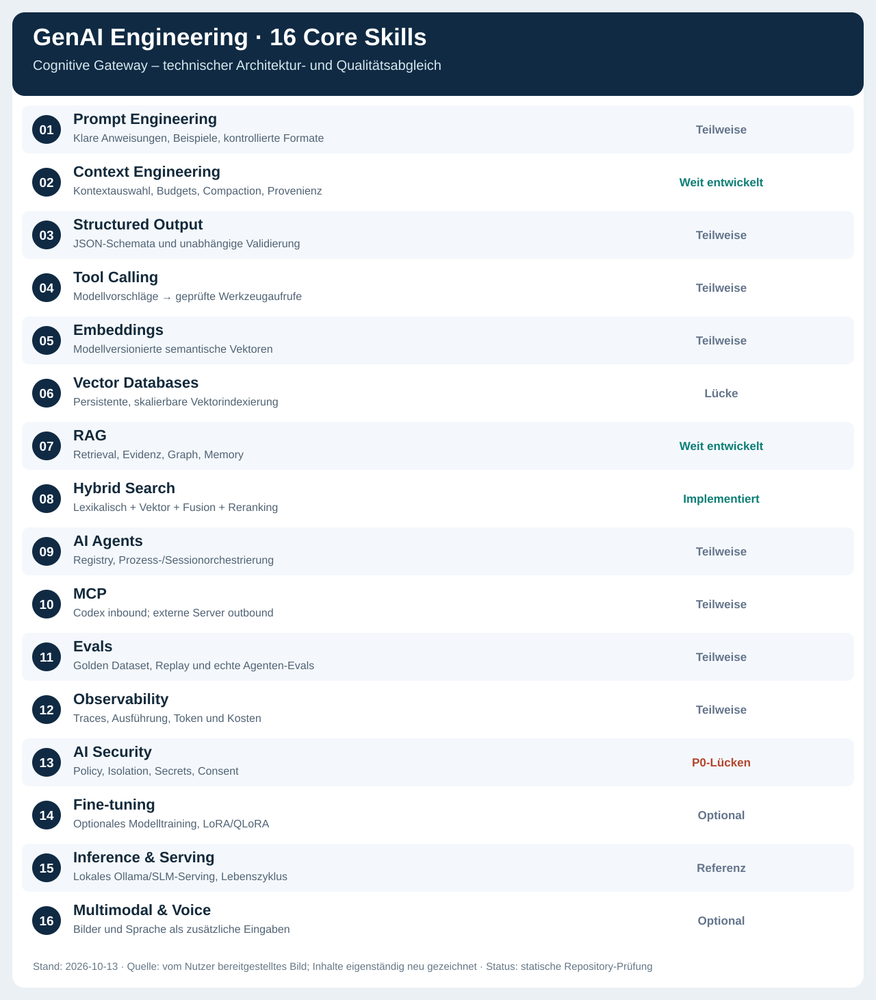
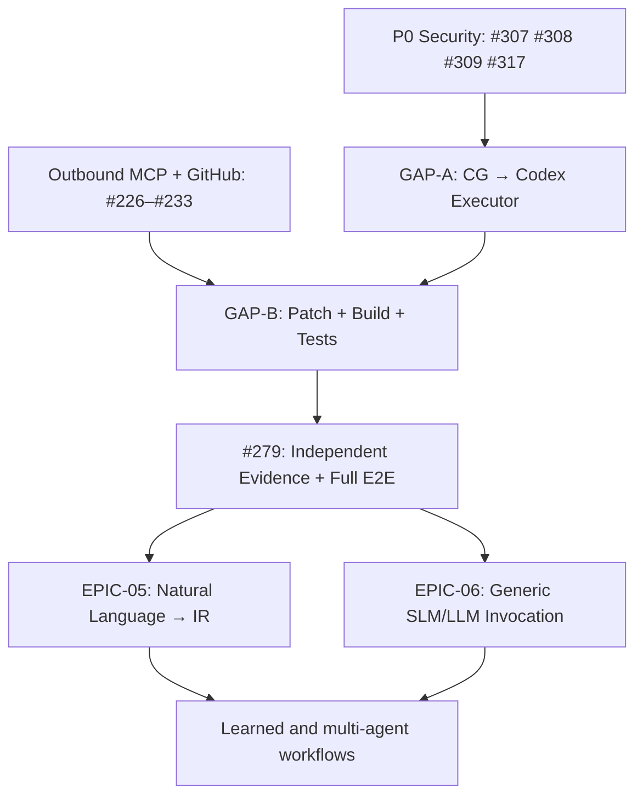
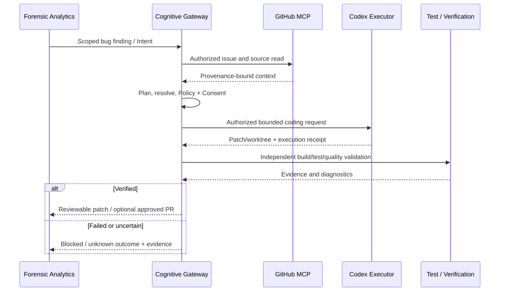

# Quality Assessment – GenAI Engineering & Cognitive Gateway

> **Status:** Architecture / implementation / evidence gap assessment, **not** a release acceptance report.  
> **Stichtag:** 2026-10-13 · **Repository:** [Cognitive Gateway](https://github.com/MatthiasBurger-Coder/Cognitive-Gateway) · **untersuchter Branch:** `main` · **Snapshot vor Dokumentation:** `01044c7662b4d7db4ffbb84ae0286e144c1b7cff`  
> **Owner/Review:** Engineering proposal, ohne menschliche QA-/Security-Freigabe.  
> **Geltungsbereich:** 16 GenAI-Engineering-Kompetenzfelder aus dem bereitgestellten Social-Media-Referenzbild sowie daraus abgeleitete Qualität, Architektur, Delivery und RC1-Prioritäten.

## 1. Ausgangsbild und Interpretation

*Abbildung 1 – Inhaltlich neu gesetzte, repositoryfähige SVG-Infografik auf Basis des vom Nutzer bereitgestellten Screenshots „GEN AI Engineer – Core Skills“. Die unveränderte Social-Media-Bilddatei ist **nicht** diese Nachzeichnung. Diese Grafik ersetzt keine Validierung des tatsächlichen Softwarestands.*

Das ursprüngliche Bild nennt: Prompt Engineering, Context Engineering, Structured Output, Tool Calling, Embeddings, Vector Databases, RAG, Hybrid Search, AI Agents, MCP, Evals, Observability, AI Security, Fine-tuning, Inference & Serving und Multimodal & Voice. Es ist eine **Kompetenzlandkarte**, keine Referenzarchitektur und keine Definition of Done.

Cognitive Gateway soll **keinen weiteren Agent-Framework-Monolithen**, sondern eine modell- und projektunabhängige, deterministisch governte **AI Context & Agent Control Plane** bereitstellen. Besondere Eigenschaften gegenüber der Grafik: CGSL/SemanticTaskIR, versionierte Registry, deterministischer Plan/Process, Policy/Consent, Daten-Provenienz, Evidence, bounded execution, getrennte MCP-inbound/outbound-Boundaries, verifizierte Outcomes sowie reversible Learned Procedures.

## 2. Evidence Policy und Prüfgrenzen

| Aussageklasse | Erforderlicher Nachweis |
|---|---|
| **Implemented** | Konkreter Produktionspfad in `main` und dazugehöriger automatisierter Test oder normativer Vertrag |
| **Integrated** | Mindestens ein ausführbarer End-to-End-Pfad durch tatsächliche Host-, Port- und Adapterinstanzen |
| **Qualified** | Reproduzierbare, auf Commit/Version gebundene Tests, negative Szenarien und Messwerte |
| **Production-ready** | Freigegebene Release-Evidence inklusive Security-, Recovery-, Ressourcen- und Operator-Nachweisen |

**Dieses Dokument stützt sich auf** GitHub-Issues (open/closed), `docs/current-architecture-state.md` vom 2026-10-11, Rust-Quellcodeausschnitte, README, technische Verträge und gespeicherte Evidence-Beschreibungen. **Nicht durchgeführt wurden** ein frischer `cargo test`-/Coverage-Lauf, ein installierter Codex-E2E-Run, GitHub-Live-Connector-Tests, ein neues RC1-Security-Audit oder Performance-Lasttests. Daher **keine belastbare Prozentzahl für Produktionsreife**.

Wichtige Quellanker:
- [Aktueller Architekturstatus](https://github.com/MatthiasBurger-Coder/Cognitive-Gateway/blob/01044c7662b4d7db4ffbb84ae0286e144c1b7cff/docs/current-architecture-state.md)
- [Repository-README](https://github.com/MatthiasBurger-Coder/Cognitive-Gateway/blob/01044c7662b4d7db4ffbb84ae0286e144c1b7cff/README.md)
- [Hybrid Retrieval](https://github.com/MatthiasBurger-Coder/Cognitive-Gateway/blob/01044c7662b4d7db4ffbb84ae0286e144c1b7cff/docs/retrieval-pipeline.md)
- [Local MCP](https://github.com/MatthiasBurger-Coder/Cognitive-Gateway/blob/01044c7662b4d7db4ffbb84ae0286e144c1b7cff/docs/local-mcp-server.md)
- [Codex Installations-/Operator-Runbook](https://github.com/MatthiasBurger-Coder/Cognitive-Gateway/blob/01044c7662b4d7db4ffbb84ae0286e144c1b7cff/docs/codex-local-setup.md)
- [EPIC-04 Acceptance](https://github.com/MatthiasBurger-Coder/Cognitive-Gateway/blob/01044c7662b4d7db4ffbb84ae0286e144c1b7cff/docs/epic-04-acceptance.md)
- [Shared Session Implementation](https://github.com/MatthiasBurger-Coder/Cognitive-Gateway/blob/01044c7662b4d7db4ffbb84ae0286e144c1b7cff/docs/shared-session-implementation.md)
- [Local Model Runtime](https://github.com/MatthiasBurger-Coder/Cognitive-Gateway/blob/01044c7662b4d7db4ffbb84ae0286e144c1b7cff/docs/local-model-runtime.md)
- [Qualitätsgates](https://github.com/MatthiasBurger-Coder/Cognitive-Gateway/blob/01044c7662b4d7db4ffbb84ae0286e144c1b7cff/docs/declarative-quality-gates.md)

## 3. 16-Felder-Abdeckungsmatrix

| # | Kompetenz | Einschätzung | Konkreter Befund / Grenze | Issue-Anker |
|---|---|---|---|---|
| 01 | Prompt Engineering | Teilweise | CG-10-Kontext und Strategie-Verträge existieren; Prompt Renderer nicht vollständig integriert. | [#192](https://github.com/MatthiasBurger-Coder/Cognitive-Gateway/issues/192), [#264](https://github.com/MatthiasBurger-Coder/Cognitive-Gateway/issues/264) |
| 02 | Context Engineering | Weit entwickelt | Context Compiler, Token-Aware Budgeting/Compaction; dynamische Quellen-/Few-Shot-Auswahl offen. | [#198](https://github.com/MatthiasBurger-Coder/Cognitive-Gateway/issues/198), [#285](https://github.com/MatthiasBurger-Coder/Cognitive-Gateway/issues/285), [#286](https://github.com/MatthiasBurger-Coder/Cognitive-Gateway/issues/286) |
| 03 | Structured Output | Teilweise | Interne Versionierung/JSON vorhanden; allgemeines Parsing und Schema-/Constraint-Gate für Modellantworten offen. | [#265](https://github.com/MatthiasBurger-Coder/Cognitive-Gateway/issues/265), [#266](https://github.com/MatthiasBurger-Coder/Cognitive-Gateway/issues/266) |
| 04 | Tool Calling | Teilweise | Inbound MCP funktioniert; Modell-Tool-Proposals und authorisierter Outbound-Dispatch offen. | [#274](https://github.com/MatthiasBurger-Coder/Cognitive-Gateway/issues/274), [#227](https://github.com/MatthiasBurger-Coder/Cognitive-Gateway/issues/227) |
| 05 | Embeddings | Teilweise | EmbeddingPort/EmbeddingModel und Index-Metadaten vorhanden; produktive Provider-Qualifikation ausbaufähig. | [CG-15](https://github.com/MatthiasBurger-Coder/Cognitive-Gateway/issues/174), [#189](https://github.com/MatthiasBurger-Coder/Cognitive-Gateway/issues/189) |
| 06 | Vector Databases | Lücke für Betrieb | Austauschbarer In-Memory-Index vorhanden; persistenter Multi-Project-Vektorindex nicht nachgewiesen. | [CG-16](https://github.com/MatthiasBurger-Coder/Cognitive-Gateway/issues/175) |
| 07 | RAG | Weit entwickelt | Retrieval- und Memory-Basis, Recursive Retrieval, Graph, Evidenz und Budgetkontrolle vorhanden. | [EPIC-02](https://github.com/MatthiasBurger-Coder/Cognitive-Gateway/issues/113) |
| 08 | Hybrid Search | Implementierte Basis | Lexical, vector, exact-match, Fusion und optionales Reranking in Rust vorhanden; kein großflächiger Produktionsbenchmark. | [CG-16](https://github.com/MatthiasBurger-Coder/Cognitive-Gateway/issues/175) |
| 09 | AI Agents | Teilweise | Registry/Process/Policy/Closed Loop und begrenzte Context-Artifact-Session; freie Agentenaktionen offen. | [EPIC-08](https://github.com/MatthiasBurger-Coder/Cognitive-Gateway/issues/271) |
| 10 | MCP | Teilweise | Codex → CG stdio-MCP vorhanden; CG → externe MCP-Server noch geplant. | [EPIC-04](https://github.com/MatthiasBurger-Coder/Cognitive-Gateway/issues/126), [EPIC-07](https://github.com/MatthiasBurger-Coder/Cognitive-Gateway/issues/223) |
| 11 | Evals | Teilweise | Synthetische Golden Cases, Replay und Datenqualität; reale End-to-End-Agentenbewertung offen. | [#201](https://github.com/MatthiasBurger-Coder/Cognitive-Gateway/issues/201), [#270](https://github.com/MatthiasBurger-Coder/Cognitive-Gateway/issues/270), [#279](https://github.com/MatthiasBurger-Coder/Cognitive-Gateway/issues/279) |
| 12 | Observability | Teilweise | Audit/Evidence/CLI-Diagnostik vorhanden; Session-weites Trace/Token/Kostenmodell noch zu qualifizieren. | [#243](https://github.com/MatthiasBurger-Coder/Cognitive-Gateway/issues/243), [#278](https://github.com/MatthiasBurger-Coder/Cognitive-Gateway/issues/278) |
| 13 | AI Security | P0/P1 offen | Policy/Consent/Isolation-Basis vorhanden; Credential, Trust, Sandbox, DB, Transport- und Regression-Hardening offen. | [EPIC-09](https://github.com/MatthiasBurger-Coder/Cognitive-Gateway/issues/306) |
| 14 | Fine-tuning | Optional | Offline-Learning-/Modell-Release-Referenz ist nicht gleich produktives LoRA/QLoRA-Finetuning. | [#219](https://github.com/MatthiasBurger-Coder/Cognitive-Gateway/issues/219) |
| 15 | Inference & Serving | Referenz vorhanden | Ollama/Python, lokale Profile, Promotion/Rollback; generisches Model-Invocation-Plane noch offen. | [#249](https://github.com/MatthiasBurger-Coder/Cognitive-Gateway/issues/249), [#269](https://github.com/MatthiasBurger-Coder/Cognitive-Gateway/issues/269) |
| 16 | Multimodal & Voice | Nicht RC1-kritisch | Keine qualifizierte Bild-/Sprachpipeline nachgewiesen; für Coding-Vertical-Slice verzichtbar. | Spätere Product Discovery |

### 3.1 Bestätigte technische Stärken

1. **Deterministischer Kern:** typed Domain / ExecutionContextIR, Registry, Process Engine, Declarative Planning, Policy, Context Compiler und CG-14 Closed Loop existieren. Geschlossene Basis-Epics sind weder Live-E2E-Beweis noch Produktfreigabe.
2. **Hybrid Retrieval bereits vorhanden:** `crates/gateway-application/src/retrieval_pipeline.rs` implementiert Fusion, Quellenföderation, exakte Trefferpriorität und Reranking-Schnittstelle. `crates/gateway-daemon/src/retrieval.rs` stellt `RepositoryLexicalAdapter`, `VectorIndexAdapter`, `FederatedRetrievalPort` bereit. Der Index ist **in memory**; kein PostgreSQL/pgvector/HNSW-Produktionsindex ist hier nachgewiesen.
3. **Lokales Modell als Referenz:** `docs/local-model-runtime.md` beschreibt einen separaten Ollama/Python-Container und Rust-`LocalInferencePort`, Modellprofile, Qualifizierung, Promotion und Rollback. Das `semantic-proposal/1.0`-Beispiel ist **kein** vollständiger CGSL-Interpreter. Qwen3-8B-Profil ist Kandidat, nicht zwangsläufig qualifizierter Standard.
4. **Codex-Inbound:** `cg-mcp` implementiert lokalen stdio-MCP-Transport und einen zugelassenen Canonical Host. Die v2-Session besitzt eine **begrenzte** verifizierte Context-Artifact-Funktion; der Rust SessionCoordinator ist ausdrücklich **kein allgemeiner Modell-/Connector-Dispatcher**.
5. **Reproduzierbare Qualitätsgrundlage:** Synthetische Golden Datasets, Replay, Architekturtests und Code-Coverage-Gates sind etabliert. `>=95 %` gilt für die in der Gate-Konfiguration definierten Module/Dateien, **nicht pauschal** für sämtliche künftig gelieferten Funktionen ohne Nachweis.

### 3.2 Technische Grenzen

- **Codex → CG** (Inbound) ist nicht identisch mit **CG → Codex als Coding-Executor** (Outbound).
- **RAG/Embedding-Verträge** sind nicht automatisch eine persistente, skalengetestete Wissensplattform.
- **Synthetische Testfixtures** sind keine echten unabhängigen GitHub-, Codex- oder SLM-Live-Läufe.
- **Versionierte Modell-Vorschläge** sind keine autorisierten Aktionen und auch keine verifizierten Endzustände.
- **Issue closed** ist kein hinreichender Nachweis für Produktabnahme, falls erforderliche Runtime-Evidence fehlt.

## 4. Epic- und Issue-Abgleich

| Epic | Stand zum Snapshot | Relevanz |
|---|---|---|
| [EPIC-02 – Knowledge / Retrieval / Memory](https://github.com/MatthiasBurger-Coder/Cognitive-Gateway/issues/113) | closed | RAG-Grundlagen, Graph, Budget und synthetische Evaluation |
| [EPIC-03 – Adaptive Cognitive Runtime](https://github.com/MatthiasBurger-Coder/Cognitive-Gateway/issues/114) | closed | Learning / Reflex / Model-Routing-Referenzen, nicht der vollständige Agentenworkflow |
| [EPIC-04 – Codex No-Key Inbound](https://github.com/MatthiasBurger-Coder/Cognitive-Gateway/issues/126) | closed | MCP-Clientzugang und begrenzte Shared Session |
| [EPIC-05 – Semantic Language](https://github.com/MatthiasBurger-Coder/Cognitive-Gateway/issues/177) | open | Natural Language → validierte SemanticTaskIR; Compiler noch offen |
| [EPIC-06 – Model Invocation](https://github.com/MatthiasBurger-Coder/Cognitive-Gateway/issues/178) | open | Allgemeine Modellaufrufe, Tool-Proposals, Output-/Evidence-Verifikation |
| [EPIC-07 – MCP Connector Runtime](https://github.com/MatthiasBurger-Coder/Cognitive-Gateway/issues/223) | open | Outbound MCP, inklusive GitHub |
| [EPIC-08 – Agent Sessions](https://github.com/MatthiasBurger-Coder/Cognitive-Gateway/issues/271) | open | End-to-End-Host, echte Tool-/Coding-Ausführung und Live-Evidence |
| [EPIC-09 – Security Hardening](https://github.com/MatthiasBurger-Coder/Cognitive-Gateway/issues/306) | open | P0/P1-Sicherheits-, Isolation- und Reliability-Gates |

### 4.1 Widerspruch bei der EPIC-04-Abnahme

[EPIC-04 #126](https://github.com/MatthiasBurger-Coder/Cognitive-Gateway/issues/126) und [Acceptance Enforcement #296](https://github.com/MatthiasBurger-Coder/Cognitive-Gateway/issues/296) sind auf GitHub geschlossen. `docs/epic-04-acceptance.md` verlangt nach einer Korrektur vom **2026-10-11** weiterhin eine **frische, vollständige Reconciliation von 24 Anforderungen**. Component-, Shared Runtime- und Installed-Client-Evidence dürfen laut Dokument nur ihren **eigenen** Prüfungsumfang qualifizieren.

**Quality Finding QG-01 (P1):** Issue-Status und dokumentierter aktueller Gesamt-Abnahmestand sind nicht ohne neuen Report konsistent. Den erforderlichen vollständigen Runner `python3 tests/scripts/qualify-epic04.py --run --output target/epic04-acceptance` auf einem festgehaltenen Commit ausführen; `QUALIFIED_EPIC_04`, `epic_04_status: COMPLETE` und `closure_allowed: true` nur bei belegter Vollständigkeit übernehmen. Anschließend Issue/Evidence/Status synchronisieren. [#279](https://github.com/MatthiasBurger-Coder/Cognitive-Gateway/issues/279) bleibt **separat** und darf nicht implizit als bestanden gelten.

### 4.2 Reichweite des derzeitigen Session-Hosts

`crates/gateway-application/src/sessions/coordinator.rs` deklariert den aktuellen Scope selbst: **„registered pure CG-10 artifact task“**, *no semantic/model/connector dispatch*. Das schränkt trotz der vorhandenen `start/inspect/clarify/approve/continue/cancel/recover`-Grundlage den tatsächlich verfügbaren Produktworkflow ein.

## 5. Priorisierte Lücken und umsetzbare Maßnahmen

| Priorität | Finding / Aufgabe | Owner / Issue | Abnahmefokus |
|---|---|---|---|
| **P0** | Secrets/Credentials erkennen und zuverlässig redigieren | [HARD-01 #307](https://github.com/MatthiasBurger-Coder/Cognitive-Gateway/issues/307) | Negative Secret-Fixtures; keine Klartextwerte in Traces/Prompts |
| **P0** | Datei-Ownership/-Permissions durchsetzen | [HARD-02 #308](https://github.com/MatthiasBurger-Coder/Cognitive-Gateway/issues/308) | Symlink/Permission/Owner-Angriffe werden abgelehnt |
| **P0** | Trusted Consent-Erzeugung versiegeln | [HARD-03 #309](https://github.com/MatthiasBurger-Coder/Cognitive-Gateway/issues/309) | Client-/Modellinput kann kein VerifiedConsent herstellen |
| **P0 vor Mutationsbetrieb** | Process/Filesystem/Network-Sandbox | [HARD-11 #317](https://github.com/MatthiasBurger-Coder/Cognitive-Gateway/issues/317) | Untrusted Tools fail-closed ohne verfügbares Isolations-Backend |
| **P0** | Outbound MCP Client, Mapping, Trust, Secrets, Policy | [#226–#232](https://github.com/MatthiasBurger-Coder/Cognitive-Gateway/issues/226) | Scope, Versionsprüfung, Consent, typed outputs, timeouts |
| **P0** | GitHub MCP Referenzintegration | [#233](https://github.com/MatthiasBurger-Coder/Cognitive-Gateway/issues/233) | Issue/Repo/PR/CI-Daten mit Provenienz, negative Tests |
| **P0** | Modell-Tool-Proposal zu auth. Dispatch | [#274](https://github.com/MatthiasBurger-Coder/Cognitive-Gateway/issues/274) | Kein Tool-Aufruf ohne aktuelle Autorität |
| **P0** | Vollständiger verifizierter Coding-Workflow | [#279](https://github.com/MatthiasBurger-Coder/Cognitive-Gateway/issues/279) | Echter Patch + Tests + Evidence + sichere PR-Übergabe |
| **P0/P1** | Inferenz-Umgebung und Antwortgrößen begrenzen | [#310](https://github.com/MatthiasBurger-Coder/Cognitive-Gateway/issues/310), [#311](https://github.com/MatthiasBurger-Coder/Cognitive-Gateway/issues/311) | Ressourcen und Secret-Umgebung bleiben begrenzt |
| **P1** | Modell-Prompt-/Invocation-/Output-Schicht | [EPIC-06 #178](https://github.com/MatthiasBurger-Coder/Cognitive-Gateway/issues/178) | Typed Result, Schema, Retry, Independentevidence |
| **P1** | Semantischer Compiler und Clarification | [EPIC-05 #177](https://github.com/MatthiasBurger-Coder/Cognitive-Gateway/issues/177) | Mehrdeutigkeit stoppt; Refs auflösbar |
| **P1** | Operative Session-Observability | [#278](https://github.com/MatthiasBurger-Coder/Cognitive-Gateway/issues/278) | Run-/Task-/Tool-Correlation, Budgets, Restart |
| **P1** | EPIC-04 Gesamtabnahme versöhnen | [#296](https://github.com/MatthiasBurger-Coder/Cognitive-Gateway/issues/296) | Commit-bound fresh acceptance evidence |
| **P1** | Weitere DB-/Transport-/Integrity-Härtung | [EPIC-09 #306](https://github.com/MatthiasBurger-Coder/Cognitive-Gateway/issues/306) | Reproduzierbare RC1-Risk-Matrix |
| **P2** | Persistenter Vektorindex und inkrementelle Updates | Kandidat unter Knowledge Plane | Scoped index lifecycle, latency/rebuild benchmarks |
| **P3** | Voice, Vision, optional LoRA/QLoRA | Später | Nicht Blocker für Coding-MVP |

**Prioritätskonvention:** P0 bedeutet für den ersten **mutierenden** Realbetrieb kritisch. Der reine lokale Inspect-/Context-Artifact-Pfad kann separat und ohne diese Mutationsfreigabe getestet werden. P1/P2 hier sind eine **Empfehlung**, keine Änderung der bereits gespeicherten GitHub-Felder.

## 6. Präzise Ergänzungen zum Backlog (noch nicht erstellt)

Neue komplette Epics sind nicht nötig. Vor dem Anlegen ein Duplikat- und Abhängigkeitsreview durchführen.

### GAP-A – Codex Outbound Coding Execution Adapter (P0, EPIC-08)

**Ziel:** CG startet Codex als externen, austauschbaren Coding-Executor; **nicht** mit dem bestehenden Inbound-MCP-Server verwechseln.

**Scope:** versionierter `CodingExecutionRequest`, Worktree-/Repo-Isolation, genaue Principal/Task/Scope/Revision, zugelassene Modell-/Tool-Oberfläche, Bounded Token/Zeit/CPU/RAM, Prozess-/Netzwerk-Sandbox, Cancellation, keine ungeprüfte Schreibwirkung, signierter bzw. verifizierbarer Ergebnisverweis. Keine implizite Credential-Übernahme von Codex oder CG.

**DoD:** einfacher Probe-Task und abgelehnter Tool-Aufruf ausführbar; Sandboxing/Consent/Retry/Uncertain-Effect-Negativtests; Git-Diff/Evidence ohne Secrets; frischer CI-Report. Ownership mit [#274](https://github.com/MatthiasBurger-Coder/Cognitive-Gateway/issues/274) und [#317](https://github.com/MatthiasBurger-Coder/Cognitive-Gateway/issues/317) abstimmen.

### GAP-B – Verified Coding Change Vertical Slice (P0, EPIC-08.08)

**Ziel:** Externen Bug-Befund aufnehmen, begrenzte Codex-Codeänderung ausführen, unabhängige Tests prüfen und einen reviewbaren Patch/optional PR liefern.

**DoD:** echter GitHub-Issue-Lesevorgang über EPIC-07; Scope und Authority gebunden; eigener Worktree; Build+Tests und Negativfälle; Fehlerstatus `blocked`/ `outcome_unknown` statt Erfolg bei unklarer Wirkung; kein automatischer Merge; Commit/Evidence/Replay gebunden. Erst nach positiver QA-Freigabe darf ein kontrollierter PR erzeugt werden.

### GAP-C – Durable Vector Index & Incremental Knowledge Refresh (P2, EPIC-02-Weiterentwicklung)

**Ziel:** vorhandene Retrieval-Ports mit einem ersetzbaren persistierten Index verbinden.

**DoD:** Modell/Digest/Dimension/Scope versioniert; Snapshot-Invalidierung bei Git-/Quelldatenänderung; sichere Wiederindizierung; Cross-Scope-Negativtest; messbare Retrieval-Latenz und Recall gegen Baseline; kein Index als Authority-Quelle.

## 7. Vorgeschlagene Delivery- und Abhängigkeitsreihenfolge

**Wichtige Optimierung:** Der erste Durchstich **benötigt weder freien Natural-Language-Compiler noch Fine-tuning, Multi-Agent-Lernen oder einen eigenen generischen Modellprovider**. Er darf eine bereits strukturierte Intent-/Task-Anfrage und Codex als externen Coding-Executor verwenden. Deshalb können EPIC-05/06 parallel entwickelt werden, ohne den ersten kontrollierten E2E-Pfad zu blockieren.

**Beispiel einer echten Akzeptanzkette:**

Das Beispiel ist **Zielverhalten**, keine Behauptung, dass es am Referenzstand bereits live funktioniert.

## 8. Quality Gates bis zur ersten kontrollierten RC1

| Gate | Muss-Kriterium | Evidenz | Owner |
|---|---|---|---|
| QG-01 | Abnahmezustand EPIC-04 eindeutig, Report gültig und aktuell | `qualify-epic04.py` + manifestierte 24 Anforderungen | EPIC-04 |
| QG-02 | **Null offene P0**, relevante P1 geschlossen oder formal risikofreigegeben | Security Risk Register mit Owner, Ablaufdatum, Controls | EPIC-09 |
| QG-03 | Untrusted Daten sind nie Authority | Injection, source poisoning, tool-output laundering | EPIC-02/06/09 |
| QG-04 | Geheimnisse und Scope verlassen Trust Boundary nicht | Canary-Secrets, Redaction- und Cross-Project-Tests | EPIC-07/09 |
| QG-05 | Jeder externe Effekt benötigt aktuelle Policy-/Consent-Prüfung | Denied, stale, revoked, changed-action Negativtests | EPIC-08 |
| QG-06 | Crash/Retry führt nicht zu blindem zweiten Write | Journal-, fencing-, recovery- und uncertain-effect-Tests | EPIC-08 |
| QG-07 | Ergebnis nur bei unabhängig nachgewiesenem Desired State `verified` | Git diff, Build, Tests, Evidence-Provenienz | EPIC-08 |
| QG-08 | Deterministischer Replay darf keine Live-Aktionen ausführen | Offline replay + denied side effects | EPIC-08 |
| QG-09 | Geltende >=95%-Coverage- und Architektur-Gates ohne Ausnahme | `tests/scripts/quality-gate.py` inkl. fail-closed Negativtests | Release |
| QG-10 | Laufzeit-/Token-/Kostenbudgets und Operator-Audit verfügbar | korrelierte Session/Invocation/Tool-Messungen | EPIC-06/08 |
| QG-11 | Realer, isolierter Bugfix-End-to-End-Run erfolgreich | tatsächlicher externer Issue-Fetch, Coding-Run, unabhängig grüne Tests | EPIC-07/08 |
| QG-12 | Reproduzierbarer Dokumentationsstand | Status/ADRs/Runbook + Version/Revision/Evidence links | Architektur |

**Unverzichtbare Negativfälle:** Credential leak, forged consent, symlink escape, prompt injection, cross-scope retrieval, stale embedding index, duplicate JSON key, oversized model response, unknown/changed tool schema, connector timeout nach möglicher Mutation, denied network egress, crash/restart, cancelled session, evidence manipulation, regressive patch und falsch-grüner CI-Report.

### 8.1 Abnahmedefinition des ersten produktrelevanten Vertical Slice

- [ ] Ein realer, begrenzt berechtigter GitHub-Befund wird mit Revision/Provenienz eingelesen.
- [ ] Ein valider strukturierter Task wird geplant, resolviert und autorisiert.
- [ ] Codex wird **von CG aus** als isolierter Executor gestartet; kein unkontrolliertes Write.
- [ ] Änderungen liegen nur in einem separaten Git-Worktree/Diff vor.
- [ ] Build, Tests und relevante Sicherheits-/Architekturchecks laufen unabhängig vom Coding-Agenten.
- [ ] Kein Erfolg ohne nachweislich erfüllten Desired State, Test Evidence und verifizierten Patch.
- [ ] Fehler, Timeout, Cancellation und unbekannter externer Effekt werden explizit berichtet.
- [ ] Replay löst keinen weiteren Effekt aus; Neustart korreliert dieselbe Task-/Dispatch-ID.
- [ ] Ausgabe ist reviewbarer Patch oder explizit genehmigter PR; kein automatischer Merge.
- [ ] Audit, Trace-IDs, Modell-/Versionsmetadaten, Token-/Zeit-/Kostenbudget liegen dem Report bei.
- [ ] Alle P0- und für dieses Deployment relevanten Security-Gates sind freigegeben.
- [ ] Dokumentierter Quality-Gate-Run ist für denselben Commit qualifiziert.

## 9. Product-Reife und Entscheidung

**Bewertung:** Fortgeschrittene Plattformbasis, **noch kein qualifizierter autonomer Coding-Service**. Die Architektur ist breiter als ein gewöhnlicher GenAI-Stack, weil deterministische Autorität, überprüfbare Ergebnisse und austauschbare Adapter integrale Bestandteile sind. Das ist ein Designvorteil, solange es durch echte ausführbare Workflows belegt wird.

**Nicht behaupten:** „16/16 produktiv“, „alle Agentenfähigkeiten fertig“, „EPIC-04 vollständig qualifiziert allein aufgrund des Closed-Status“, „persistente Vector DB in Produktion“, „CG kann heute autonome Bugfixes zurückliefern“, oder eine erfundene Prozent-Reife.

**Entscheidungsvorschlag:** Keine neue große Feature-Epic; P0-Hardening priorisieren und GitHub/MCP-Connector aufbauen, GAP-A und GAP-B eindeutig schneiden, anschließend [#279](https://github.com/MatthiasBurger-Coder/Cognitive-Gateway/issues/279) mit echten Effekten qualifizieren. Natural-Language-Interpretation, allgemeine Model Invocation, persistente Vector DB und Multimodalität danach in den jeweils zuständigen bestehenden Epics weiterführen.

## 10. Nacharbeiten dieses Dokuments

- [ ] Owner für Findings und P0/P1-Risk-Acceptance zuweisen.
- [ ] GAP-A/B/C vor Erstellung auf Duplikate und Dependencies prüfen.
- [ ] EPIC-04-Status gegen frische vollständige Evidence abgleichen.
- [ ] Eine echte, versionsgebundene Rust/CI/Codex/Connector-Live-Qualifikation durchführen.
- [ ] Statusmatrix nach jedem qualifizierten Release aktualisieren.
- [ ] Das ursprüngliche hochgeladene Screenshot-Asset nur bei entsprechender Freigabe/technischem Bild-Upload zusätzlich als Originaldatei versionieren.

---
*Autor: Architektur-/Qualitätsanalyse auf Basis des geprüften GitHub-Snapshots, keine unabhängige Release-Zertifizierung. Definitions- und Dokumentationsquelle bleibt das Repository. Bei Änderung von Code oder Issues ist diese Analyse neu zu validieren.*
