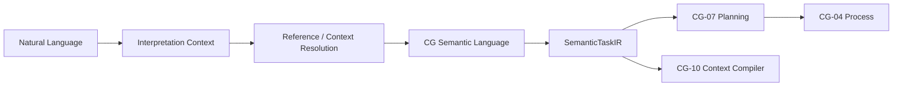

# CGSL, SemanticTaskIR and Natural-Language Interpretation

## Status

**Implemented components; complete hosted natural-language path remains partial — 2026-10-17.**

The [implementer guide](cgsl-implementer-guide.md) indexes the complete normative
language/task specifications, contextual and epistemic contracts, conformance
corpus, migration rules and reference examples. Formal CGSL compiles offline.
Contextual resolution, completeness and CG-06/07/08 handoff have component proofs;
a deployed general natural-language-to-execution path is not qualified.

## Purpose

CGSL and `SemanticTaskIR` form the semantic boundary between ambiguous human language and deterministic planning/execution.

The governing rule is:

> Natural language may express intent. Resolved Cognitive Gateway semantics must express unambiguous meaning.

## Separation of responsibilities

### CGSL / SemanticTaskIR

Describes **what the task means**: goal, target, input, state, desired state, evidence, assumptions, constraints, required capabilities, output and verification contracts.

### Process IR / Strict Cognitive Gherkin

Describes **how controlled execution proceeds**: activities, legal transitions, readiness and process lifecycle.

### Prompt / Execution rendering

Describes **how a selected runtime/provider receives the already constrained task**. Provider prompts, templates, sampling configuration and model-specific options do not belong in CGSL.

## Interpretation flow

1. Accept natural-language input.
2. Assemble only relevant request-scoped interpretation context.
3. Resolve entities and references using explicit precedence.
4. Represent unresolved, ambiguous or conflicting fields explicitly.
5. Request clarification or additional evidence when mandatory semantics cannot be resolved.
6. Compile valid semantics into canonical `SemanticTaskIR`.
7. Hand the validated IR to existing planning/resolution/context boundaries.

A model or SLM may assist steps 2–4 by proposing candidates, but the canonical result must pass deterministic schema and semantic validation.

The [epistemic contract](semantic-epistemic-contract.md) defines classification
and admissibility. The deterministic resolver and completeness compiler preserve
that boundary; their trusted host ports must authenticate captured sources.

## Required epistemic separation

The semantic layer preserves the difference between:

- fact;
- observation;
- evidence;
- inference;
- hypothesis;
- assumption;
- unresolved knowledge gap.

A hypothesis cannot silently become a fact, and a model-generated value cannot silently become verified evidence.

## Current implementation boundary

As of 2026-10-17:

| Component | Delivered scope |
| --- | --- |
| [CGSL frontend](cgsl-frontend.md) | Strict parser/AST, typed source compiler, canonical formatter and semantic serializer |
| [Task contract](semantic-task-ir-v1.md) | Typed Rust and wire contract, canonical bytes/digest, exact independently versioned pins |
| [Resolver](deterministic-interpretation-resolution.md) | Captured-context admission, scoped entities/aliases, precedence, temporal anchors and candidate traces |
| [Completeness](semantic-completeness.md) | Host-authenticated requirement manifest, dependency frontier, clarification plan and revalidated compilation |
| [Optional proposal adapters](interpretation-adapters.md) | Deterministic-first proposals with validation and unavailable-model fallback; no model authority |
| [Planning adapter](semantic-planning-boundaries.md) | Existing CG-06/07/08 delegation, immutable task/source/Plan envelope and revalidation |
| [Process boundary](semantic-process-boundary.md) | Executable exact-definition/activity proof; lifecycle and gates remain CG-04-owned |
| [Prompt boundary](prompt-ir-handoff-boundary.md) | Normative section/admission contract and two offline renderings; not a production invocation IR |
| [Conformance](cgsl-conformance.md) | Frozen source/IR/digest vectors, generated roundtrips and adversarial component tests |

Canonical context requirement/source planning (#285), example selection (#286),
production invocation admission (#263), persisted clarification hosting (#275) and
full runtime proof (#279) remain downstream work. Structured callers continue to
use existing APIs. Formal CGSL callers must compose the trusted admission ports;
a successful frontend task shape alone is insufficient for execution.
